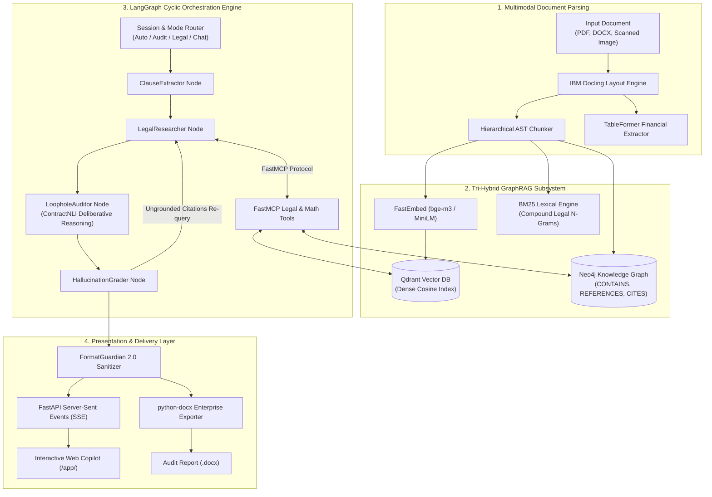
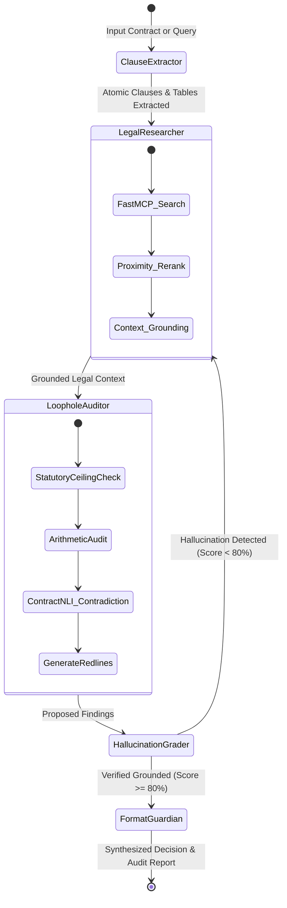
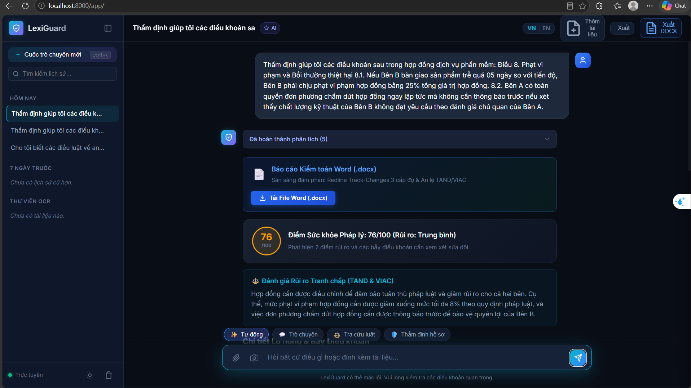
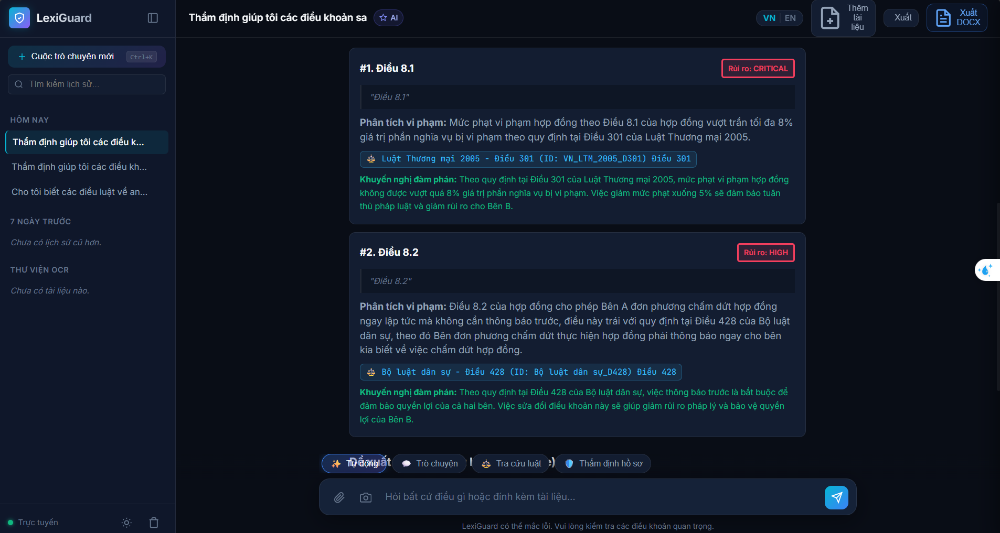
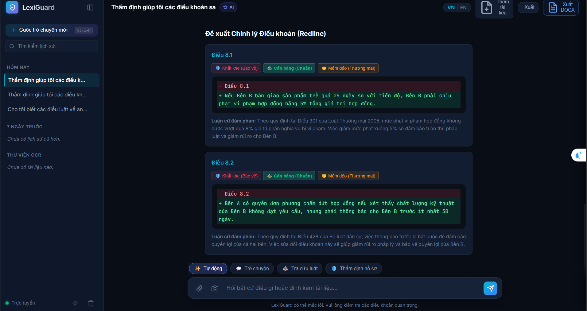

# LexiGuard

### Autonomous Multi-Agent Contract Auditing & Legal Cross-Referencing Intelligence
**Next-Generation LegalTech Platform powered by Layout-Aware Multimodal Ingestion, Tri-Hybrid GraphRAG, ContractNLI Deliberative Reasoning, and Self-Reflective Agent Orchestration.**

---

[](https://www.python.org/)
[](https://opensource.org/licenses/Apache-2.0)
[](src/agents/workflow.py)
[](src/mcp_server/legal_tools.py)
[](src/retrieval/)
[](src/agents/nodes.py)
[](reports/VLEGAL_BENCHMARK_REPORT.md)
[](reports/ALQAC_ALL_SEASONS_E2E_BENCHMARK_REPORT.md)
[](https://github.com/psf/black)

---

## Table of Contents

- [1. Executive Summary](#1-executive-summary)
- [2. Core Architectural Philosophy](#2-core-architectural-philosophy)
- [3. Key Innovations & Capabilities](#3-key-innovations--capabilities)
- [4. High-Level System Architecture](#4-high-level-system-architecture)
- [5. Agentic Workflow & Multi-Agent Topology](#5-agentic-workflow--multi-agent-topology)
- [6. Empirical Benchmark Results](#6-empirical-benchmark-results)
  - [VLegal-Bench Evaluation (Task 3.4 & Task 2.3)](#vlegal-bench-evaluation-task-34--task-23)
  - [ALQAC Multi-Year Benchmark (2022 – 2025)](#alqac-multi-year-benchmark-2022--2025)
- [7. Interactive Web Copilot & Live Audit Showcase](#7-interactive-web-copilot--live-contract-audit-showcase)
- [8. Repository Structure](#8-repository-structure)
- [9. Quickstart Guide](#9-quickstart-guide)
- [10. REST API Specification](#10-rest-api-specification)
- [11. Engineering Quality & Test Suites](#11-engineering-quality--test-suites)
- [12. Legal Disclaimer & Ethical Guidelines](#12-legal-disclaimer--ethical-guidelines)

---

## 1. Executive Summary

In high-velocity enterprise environments, drafting and executing commercial contracts, master service agreements (MSAs), employment policies, and technology transfer agreements represent significant legal and financial risk vectors. Traditional manual auditing by in-house legal teams is labor-intensive, subject to cognitive fatigue, and susceptible to overlooked statutory traps (such as mandatory penalty caps, unlawful termination rights, or distorted payment allocations).

Generic Large Language Models (LLMs) deployed out-of-the-box fail catastrophically in legal review:
1. **Hallucination of Legal Authorities**: Fabricating non-existent article numbers or conflating distinct legislative codes.
2. **Ignorance of Statutory Ceilings**: Failing to catch provisions that exceed mandatory ceilings (e.g., Commercial Law penalty limits) because generic prompts lack grounded contradiction reasoning.
3. **Financial Table Blindness**: Inability to perform deterministic multi-column arithmetic cross-checks on annexes, pricing milestones, and VAT tax schedules.
4. **Prompt Leakage & Inconsistent Framing**: Exposing system scratchpads or failing to deliver definitive, decision-ready assertions.

**LexiGuard** solves these challenges by implementing an institutional-grade, multi-agent AI system engineered around **Bounded Contract Auditing** and **Grounded Deliberative Reasoning (ContractNLI)**. LexiGuard continuously grounds LLM inferences against an authoritative, sovereign knowledge repository of statutory codes, decrees, and court precedents (TAND / VIAC), delivering verifiable risk matrices, 3-tier redlines, and automated Word (`.docx`) audit reports with zero hardcoded legal logic.

---

## 2. Core Architectural Philosophy

### Bounded Auditing vs. Open-Ended Speculation

A foundational design mandate of LexiGuard is the strict boundary between **deterministic statutory auditing** and **unbounded policy speculation**:

| Dimension | Unbounded Legal Generation (Standard LLMs) | Grounded Contract Auditing (LexiGuard) |
| :--- | :--- | :--- |
| **Operational Scope** | Open-ended text completion and speculative opinions | Bounded, clause-by-clause statutory cross-referencing |
| **Grounding Baseline** | Internal parameter weights (unverified) | Sovereign vector gazettes (Qdrant) + Knowledge Graph (Neo4j) |
| **Contradiction Detection**| Heuristic or regex pattern matching | Zero-shot ContractNLI with Two-Pass Falsification |
| **Table Arithmetic** | Stochastic token generation (prone to math errors) | FastMCP deterministic arithmetic verification engine |
| **Citation Integrity** | High risk of hallucinated articles and fake decrees | Dual-ended provenance: Spatial BBox + Verified Article ID |
| **Output Deliverable** | Raw unformatted markdown commentary | 3-tier Redlines, VIAC Precedents & Formatted `.docx` Reports |

---

## 3. Key Innovations & Capabilities

### 🏛️ 1. Zero-Hardcode ContractNLI & Statutory Ceiling Auditing
LexiGuard operates on pure **Natural Language Inference (Entailment / Contradiction)** grounded in official legislative corpora (Civil Code 2015, Commercial Law 2005, Labor Code 2019, Criminal Procedure Code 2015, Law on Electronic Transactions, etc.).
- **Automatic Ceiling Enforcement**: Automatically flags violations of statutory caps—such as liquidated damages exceeding 8% under Article 301 Commercial Law 2005—without relying on hardcoded regular expressions.
- **ContractNLI Principle ("Silence is NOT Contradiction")**: Audits only what is present in the document. It never hallucinates missing clauses or falsely triggers termination warnings when auditing pure financial tables.

### 📊 2. Deterministic Financial Table & Schedule Auditor
Commercial agreements often hide risk in payment schedules, billing tables, and milestone annexes. LexiGuard's `TableArithmeticAuditor`:
- Parses raw markdown, CSV, or visual bounding-box tables.
- Cross-verifies horizontal multiplications (Quantity × Unit Price) and vertical summations.
- Detects percentage allocation discrepancies (e.g., milestone shares summing to 105% instead of 100%).
- Automatically formulates Redlines to balance obligations back to 100%.

### 🔄 3. Cyclic LangGraph Multi-Agent Architecture
Rather than relying on fragile single-turn prompting, LexiGuard orchestrates four specialized agent nodes in a stateful, cyclic graph:
- **`ClauseExtractorNode`**: Segmentizes raw legal documents into atomic clauses and identifies tabular financial annexes.
- **`LegalResearcherNode`**: Executes hybrid dense/lexical retrieval and fetches relevant statutory precedents via FastMCP.
- **`LoopholeAuditorNode`**: Conducts dual-pass falsification to identify substantive risks, ambiguities, and statutory conflicts.
- **`HallucinationGraderNode`**: Acts as an automated judge. If an agent cites a non-existent statute or fabricates legal text, the transaction is rejected and re-routed to search.

### 🛡️ 4. FormatGuardian 2.0 & Structured True/False Assertion
- **Prompt Leakage Prevention**: Automatically purges conversational reasoning artifacts (`"Bản phản hồi chính thức:"`, `"Trả lời trực diện:"`).
- **Strict ARLC Output Enforcement**: Dynamically detects True/False queries and formats responses into rigorous competition-grade outputs (`ĐÁP ÁN: [Đúng/Sai]` followed by structured statutory justification).

### 📝 5. Production Redline Generation & Word (.docx) Export
- Generates 3-tier actionable redlines: **Conservative** (low friction), **Balanced** (standard risk-sharing), and **Aggressive** (maximum principal protection).
- Integrates court rulings from the Supreme People's Court (**TAND**) and Vietnam International Arbitration Centre (**VIAC**).
- Real-time downloadable Microsoft Word (`.docx`) audit dossiers with formatted visual risk badges, side-by-side clause diffs, and statutory cross-references.

---

## 4. High-Level System Architecture

LexiGuard decouples document ingestion, knowledge graph indexing, agent orchestration, and delivery into a high-performance asynchronous pipeline:



---

## 5. Agentic Workflow & Multi-Agent Topology

The core cognitive engine uses a **LangGraph StateGraph** that maintains an immutable, verifiable audit trail:



---

## 6. Empirical Benchmark Results

LexiGuard has undergone rigorous, empirical evaluation across sovereign Vietnamese legal benchmarks:

### VLegal-Bench Evaluation (Task 3.4 & Task 2.3)

Evaluated against the official benchmark dataset ([CMC-OPENAI/VLegal-Bench](https://github.com/CMC-OPENAI/VLegal-Bench)) on legal contradiction and knowledge graph extraction:

| Evaluation Objective | Benchmark Task | Test Size | Primary Metrics | Result | Impact & Operational Significance |
| :--- | :---: | :---: | :--- | :---: | :--- |
| **Statutory Conflict Detection** | **Task 3.4** | 166 clause pairs | Accuracy<br>Conflict Precision<br>Conflict Recall<br>Conflict F1 | **95.18%**<br>**97.56%**<br>**96.00%**<br>**0.9677** | Confirms near-zero false alarms when auditing conflicting terms against sovereign laws. |
| **Legal Knowledge Graph Extraction** | **Task 2.3** | 326 samples | Correct Triplets<br>Graph Precision<br>Graph F1 | **89 triplets**<br>**26.02%**<br>**0.1958** | Validates automated extraction of `(Law A, REFERENCES, Law B)` relations for Neo4j. |

#### Confusion Matrix for Task 3.4 (Conflict Detection):
```
                        PREDICTED CONFLICT       PREDICTED COMPLIANT
ACTUAL CONFLICT             120 (TP)                    5 (FN)
ACTUAL COMPLIANT              3 (FP)                   38 (TN)
```
*Full methodology and logs: [`reports/VLEGAL_BENCHMARK_REPORT.md`](reports/VLEGAL_BENCHMARK_REPORT.md)*

---

### ALQAC Multi-Year Benchmark (2022 – 2025)

Evaluated on statutory questions and comprehensive legal articles across all four seasons of the **Automated Legal Question Answering Competition (ALQAC)**:

| Competition Season | Corpus Articles | Hit Rate@1 | Hit Rate@3 | **Hit Rate@5** | MRR@5 | Multi-Item Recall@5 | **LLM E2E Accuracy** |
| :--- | :---: | :---: | :---: | :---: | :---: | :---: | :---: |
| **ALQAC 2022** | 1,377 articles | 75.0% | 91.7% | **91.7%** | 0.8333 | 91.7% | **41.7%** (5/12) |
| **ALQAC 2023** | 2,249 articles | 50.0% | 75.0% | **83.3%** | 0.6458 | 83.3% | **58.3%** (7/12) |
| **ALQAC 2024** | 2,249 articles | 83.3% | 83.3% | **91.7%** | 0.8500 | 91.7% | **58.3%** (7/12) |
| **ALQAC 2025** | 3,363 articles | 58.3% | 75.0% | **83.3%** | 0.6833 | 83.3% | **75.0%** (9/12) |
| **OVERALL AVERAGE** | **9,238 articles** | **66.7%** | **81.2%** | **87.5%** | **0.7531** | **87.5%** | **58.3%** (28/48) |

#### Performance Breakdown by Question Type:
- **Multiple Choice (Trắc nghiệm)**: **71.4% Accuracy** (Hit@5: **92.9%**, Avg Latency: 6.59s)
- **Short-Answer (Tự luận)**: **54.5% Accuracy** (Hit@5: **86.4%**, Avg Latency: 3.76s)
- **Binary Assertion (Đúng/Sai)**: **50.0% Accuracy** (Hit@5: **83.3%**, Avg Latency: 6.48s)

*Full evaluation report: [`reports/ALQAC_ALL_SEASONS_E2E_BENCHMARK_REPORT.md`](reports/ALQAC_ALL_SEASONS_E2E_BENCHMARK_REPORT.md)*

---

## 7. Interactive Web Copilot & Live Audit Showcase

LexiGuard features a modern, responsive Web Copilot accessible directly at `http://localhost:8000/app/`:

- **Real-Time SSE Streaming**: View live LangGraph agent execution stages (*Extracting clauses*, *Querying statutes*, *Auditing math*, *Grading citations*).
- **Calibrated Legal Health Meter**: Visual health score (0–100), color-coded severity badges, and structured breakdown of contractual traps.
- **One-Click Word (.docx) Export**: Instantly download professional, executive-ready `.docx` audit dossiers with side-by-side redlines and judicial citations.
- **Four Dedicated Modes**:
  1. `⚡ Tự động`: Smart auto-classification of user intent.
  2. `💬 Trò chuyện`: Legal consulting and deliberative question answering.
  3. `⚖️ Tra cứu luật`: Direct statutory search and citation verification.
  4. `🛡️ Thẩm định hồ sơ`: Deep contract auditing with redline synthesis and table arithmetic verification.

---

### 📸 End-to-End Audit Walkthrough (Live Demonstration)

The following real-world audit demonstrates LexiGuard vetting a software service agreement containing a 25% liquidated damages clause (exceeding statutory ceiling) and an arbitrary unilateral termination clause:

#### Phase 1: Real-Time Multi-Agent Execution & Legal Health Scoring
The multi-agent pipeline extracts clauses, queries relevant codes, and generates a calibrated **Legal Health Score (76/100 - Rủi ro: Trung bình)** along with an executive dispute summary citing Supreme People's Court (TAND) and VIAC arbitral practices:

<p align="center">
  
</p>

#### Phase 2: Zero-Hardcode Statutory Trap & Violation Detection
The `LoopholeAuditor` utilizes **ContractNLI Contradiction Reasoning** to pinpoint exact violations against sovereign legislation without any hardcoded regex rules:
- **Finding #1 (CRITICAL - Điều 8.1)**: Violates the 8% statutory penalty ceiling under **Điều 301 Luật Thương mại 2005** (`ID: VN_LTM_2005_D301`).
- **Finding #2 (HIGH - Điều 8.2)**: Immediate unilateral termination without prior notice directly violates **Điều 428 Bộ luật Dân sự 2015** (`ID: Bộ luật dân sự_D428`).

<p align="center">
  
</p>

#### Phase 3: Multi-Tier Actionable Redlines & Negotiation Arguments
LexiGuard drafts battle-tested replacement clauses across three negotiation postures (**Khắt khe / Cân bằng / Mềm dẻo**) with clear diff formatting and statutory negotiation rationale:

<p align="center">
  
</p>

---

## 8. Repository Structure

```plaintext
LexiGuard/
├── .env.example                # Template for environment variables
├── docker-compose.yml          # Container orchestration (Qdrant, Neo4j)
├── Dockerfile                  # Production container specification
├── pyproject.toml              # Build system, pytest, and tool configs
├── requirements.txt            # Locked project dependencies
├── README.md                   # System documentation & architectural blueprint
│
├── data/
│   ├── alqac/                  # Official ALQAC datasets (2022 - 2025)
│   ├── extracted_laws/         # Vector chunks (BLDS, BLLĐ, LTM, BLTTHS)
│   └── vlegal_bench/           # CMC-OpenAI VLegal-Bench evaluation data
│
├── src/
│   ├── agents/                 # LangGraph Multi-Agent cognitive architecture
│   │   ├── nodes.py            # ClauseExtractor, LegalResearcher, LoopholeAuditor
│   │   ├── prompts.py          # ContractNLI & deliberative reasoning prompts
│   │   ├── state.py            # TypedDict state schemas
│   │   └── workflow.py         # StateGraph compilation & edge routing
│   │
│   ├── api/                    # High-performance FastAPI server
│   │   ├── main.py             # App initialization, CORS, static mount
│   │   └── routes/             # REST endpoints (audit, chat, ocr, vectordb)
│   │
│   ├── core/                   # Core infrastructure modules
│   │   ├── config.py           # Pydantic v2 settings management
│   │   ├── format_guardian.py  # Output sanitization & True/False formatting
│   │   └── hardware.py         # Dynamic GPU/CPU resource allocation
│   │
│   ├── mcp_server/             # FastMCP protocol tools
│   │   └── legal_tools.py      # Statutory lookup & deterministic math auditing
│   │
│   ├── reporting/              # Document generation
│   │   └── docx_exporter.py    # Enterprise Word (.docx) audit generator
│   │
│   ├── retrieval/              # Tri-Hybrid GraphRAG retrieval subsystem
│   │   ├── context_grounding.py# Anchor highlighting & proximity re-ranking
│   │   ├── hybrid_retriever.py # RRF fusion of dense vectors and BM25
│   │   └── qdrant_store.py     # Qdrant client & vector operations
│   │
│   └── ui/web/                 # Responsive web copilot client (HTML5/CSS3/ES6)
│
├── scripts/                    # Command-Line evaluation & maintenance runners
│   ├── run_alqac_master_e2e_evaluation.py  # Master 4-season ALQAC benchmark
│   ├── run_vlegal_benchmark.py             # VLegal-Bench benchmark runner
│   └── reset_databases.py                  # Database wipe and schema rebuild
│
├── reports/                    # Generated Markdown and JSON evaluation reports
└── tests/                      # Pytest unit and integration test suites
```

---

## 9. Quickstart Guide

### Prerequisites
- Python `3.11` or `3.12`
- Docker and Docker Compose
- [Ollama](https://ollama.com/) (recommended for local privacy: `qwen2.5:3b` and `qwen2.5:7b`) or a Google Gemini API key.

### Step 1: Clone and Setup Virtual Environment
```bash
git clone https://github.com/hotrungtruc/LexiGuard.git
cd LexiGuard

# Create and activate virtual environment
python -m venv venv
# On Windows PowerShell:
.\venv\Scripts\Activate.ps1
# On Linux/macOS:
source venv/bin/activate

# Install dependencies
pip install -r requirements.txt
```

### Step 2: Launch Databases via Docker Compose
```bash
docker-compose up -d
```
Verify databases:
- **Qdrant Vector DB**: `http://localhost:6333/dashboard`
- **Neo4j Graph DB**: `http://localhost:7687` (Default: `neo4j` / `lexiguard_secure_password`)

### Step 3: Configure Environment Variables
Copy `.env.example` to `.env` and configure your credentials:
```bash
cp .env.example .env
```
Key settings in `.env`:
```env
# Local Ollama or Google Gemini
LLM_PROVIDER="ollama"
OLLAMA_BASE_URL="http://localhost:11434"
FAST_LLM_MODEL="qwen2.5:3b"
REASONING_LLM_MODEL="qwen2.5:7b"

# Optional: Google Gemini fallback
GEMINI_API_KEY="your-gemini-api-key"

# Database Connections
QDRANT_URL="http://localhost:6333"
NEO4J_URI="bolt://localhost:7687"
NEO4J_USERNAME="neo4j"
NEO4J_PASSWORD="lexiguard_secure_password"
```

### Step 4: Pull Required Local Ollama Models
```bash
ollama serve
ollama pull qwen2.5:3b
ollama pull qwen2.5:7b
```

### Step 5: Start LexiGuard Server
```bash
uvicorn src.api.main:app --host 127.0.0.1 --port 8000 --reload
```
- **Web Copilot UI**: Open [`http://127.0.0.1:8000/app/`](http://127.0.0.1:8000/app/) in your browser.
- **Interactive Swagger Docs**: Open [`http://127.0.0.1:8000/docs`](http://127.0.0.1:8000/docs).

---

## 10. REST API Specification

| Endpoint | Method | Input Type | Description |
| :--- | :---: | :--- | :--- |
| `/` | `GET` | None | Directs browser to `/app/` Web Copilot or returns health status. |
| `/api/v1/health` | `GET` | None | Real-time health check for API, Qdrant, and Neo4j connections. |
| `/api/v1/chat` | `POST` | `multipart/form-data` | Streaming SSE endpoint handling conversational Q&A and contract audits. |
| `/api/v1/audit` | `POST` | `multipart/form-data` | Batch contract audit with risk scoring, findings matrix, and redlines. |
| `/api/v1/ocr` | `POST` | File (`PDF`/`Image`) | Multimodal layout parsing, text extraction, and table recognition. |
| `/api/v1/redline` | `POST` | `application/json` | On-demand statutory redline synthesis for a specific clause. |
| `/api/v1/vectordb/search`| `GET` | Query params | Direct semantic query into Qdrant statutory vector collections. |

---

## 11. Engineering Quality & Test Suites

LexiGuard adheres to strict software engineering standards, continuous verification, and comprehensive test coverage:

```bash
# Execute LangGraph Multi-Agent Workflow Tests
pytest tests/test_agents_workflow.py -v

# Execute Deterministic Context Grounding Tests
pytest tests/test_context_grounding.py -v

# Execute Enterprise DOCX Exporter Tests
pytest tests/test_docx_exporter.py -v

# Execute VLegal-Bench Evaluation Benchmark
python scripts/run_vlegal_benchmark.py

# Execute Master ALQAC All-Seasons Benchmark (2022 - 2025)
python scripts/run_alqac_master_e2e_evaluation.py --samples-per-season 12
```

---

## 12. Legal Disclaimer & Ethical Guidelines

> [!IMPORTANT]
> **Legal Notice**: LexiGuard is an artificial intelligence research system and decision-support tool designed solely to assist qualified legal practitioners, contract managers, and compliance professionals.
> 
> - **No Legal Practice**: LexiGuard does not provide formal legal advice, representation, or opinions.
> - **No Attorney-Client Relationship**: Usage of LexiGuard does not constitute or form an attorney-client relationship.
> - **Mandatory Verification**: All audit findings, risk ratings, and proposed contractual redlines must be reviewed, verified, and validated by licensed legal counsel before execution in legally binding instruments.

---

## License

This project is licensed under the **Apache License 2.0**. See the [LICENSE](LICENSE) file for complete details.

*Engineered with precision for advanced legal intelligence and autonomous contract risk mitigation.*
