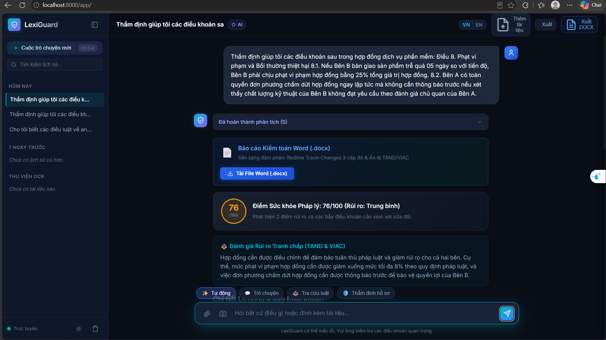
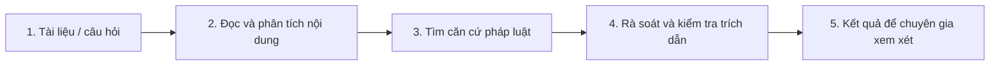

# LexiGuard

**Trợ lý AI hỗ trợ rà soát hợp đồng và tra cứu pháp luật Việt Nam.**

LexiGuard giúp người dùng đọc tài liệu, tìm căn cứ pháp luật liên quan và
nhận diện các điều khoản có thể cần xem xét. Kết quả là **gợi ý hỗ trợ ra
quyết định**, không thay thế ý kiến của chuyên gia pháp lý.

[Bài toán](#bài-toán) · [Cách hoạt động](#cách-hoạt-động) ·
[Kết quả đánh giá](#kết-quả-đánh-giá) · [Bắt đầu](#bắt-đầu) ·
[Tài liệu chuyên sâu](#tài-liệu-chuyên-sâu)

---

## Bài toán

Một hợp đồng có thể gồm nhiều điều khoản, phụ lục và bảng tính. Người rà soát
cần đối chiếu nội dung với văn bản pháp luật phù hợp, đánh giá rủi ro và chuẩn
bị phương án đàm phán. Công việc này tốn thời gian, đặc biệt khi tài liệu dài,
là bản scan hoặc cần tra cứu nhiều văn bản.

LexiGuard được thiết kế để hỗ trợ bước rà soát ban đầu:

| Người dùng | LexiGuard có thể hỗ trợ |
| --- | --- |
| **Chủ doanh nghiệp, quản lý hợp đồng** | Nắm nhanh những điều khoản được đánh dấu có rủi ro và phương án sửa đổi được đề xuất. |
| **Chuyên viên pháp lý, tuân thủ** | Tìm nội dung hợp đồng, căn cứ pháp luật liên quan và các điểm cần kiểm tra thêm. |
| **Nhóm công nghệ** | Tích hợp giao diện web hoặc API, quản lý nguồn dữ liệu pháp luật và đánh giá từng thành phần. |

### Ví dụ sử dụng

Một hợp đồng dịch vụ có điều khoản phạt và bảng thanh toán. Người dùng tải hợp
đồng lên, yêu cầu rà soát; hệ thống trích xuất nội dung, tra cứu căn cứ liên
quan, kiểm tra phép tính trong bảng và đề xuất nhận xét hoặc câu chữ thay thế.
Chuyên viên pháp lý sau đó kiểm tra lại nội dung, căn cứ, hiệu lực văn bản và
bối cảnh giao dịch trước khi quyết định.

## LexiGuard làm được gì?

- **Đọc tài liệu:** trích xuất văn bản, cấu trúc và bảng từ tài liệu được hỗ trợ;
  có OCR cho tài liệu scan.
- **Tra cứu căn cứ:** tìm kiếm theo nội dung và từ khóa, kết hợp quan hệ giữa
  các văn bản trong cơ sở tri thức.
- **Hỗ trợ rà soát:** tạo nhận xét rủi ro, căn cứ và đề xuất sửa đổi
  (*redline*) theo nội dung và dữ liệu được truy xuất.
- **Kiểm tra bảng số liệu:** đối chiếu một số phép nhân, tổng và tỷ lệ trong
  bảng; kết quả phụ thuộc vào cấu trúc bảng được nhận diện.
- **Trao đổi và xuất báo cáo:** sử dụng giao diện web để đặt câu hỏi, rà soát
  tài liệu và xuất báo cáo Word.

Các khả năng trên phụ thuộc vào chất lượng tài liệu đầu vào, mô hình, cấu hình
và nội dung pháp luật đã được nạp. Kết quả có thể thiếu, sai hoặc dẫn nguồn
chưa phù hợp; mọi phát hiện và đề xuất đều cần được con người thẩm định.



*Hình ảnh minh họa giao diện; kết quả thực tế phụ thuộc vào tài liệu và cấu hình.*

## Cách hoạt động



1. **Đầu vào:** người dùng gửi câu hỏi hoặc tài liệu cần rà soát.
2. **Đọc tài liệu:** hệ thống phân tích bố cục, văn bản và bảng; OCR được sử
   dụng khi cấu hình và tài liệu yêu cầu.
3. **Tìm căn cứ:** kết hợp tìm kiếm ngữ nghĩa, từ khóa và quan hệ trong đồ thị
   pháp luật. Chất lượng phụ thuộc vào dữ liệu đã nạp và trạng thái hiệu lực.
4. **Rà soát:** quy trình LangGraph trích xuất điều khoản, truy xuất căn cứ,
   tạo nhận xét và kiểm tra trích dẫn; có vòng thử sửa khi kiểm tra thất bại.
5. **Thẩm định:** người dùng xem xét kết quả, kiểm tra nguồn gốc và quyết định
   việc sửa đổi với sự hỗ trợ của chuyên gia pháp lý.

Tìm kiếm và kiểm tra trích dẫn **không bảo đảm** mọi căn cứ đều đầy đủ, chính
xác hoặc còn hiệu lực. Cập nhật kho tri thức và kiểm tra nguồn luật chính thức
là trách nhiệm vận hành.

## Kết quả đánh giá

Các kết quả dưới đây được trích từ báo cáo lưu trong repository, **không phải
cam kết hiệu năng trong môi trường thực tế**:

| Đánh giá | Phạm vi và phương pháp | Kết quả được báo cáo | Cách hiểu |
| --- | --- | --- | --- |
| VLegal-Bench, Task 3.4 | 166 cặp quy phạm; bộ đánh giá phát hiện mâu thuẫn dùng các quy tắc trong evaluator. | Accuracy **95,18%**; 5 trường hợp mâu thuẫn bị bỏ sót. | Đây là kết quả của tác vụ và bộ đánh giá cụ thể, không phải độ chính xác rà soát hợp đồng đầu-cuối. |
| VLegal-Bench, Task 2.3 | 326 mẫu trích xuất quan hệ pháp lý; so khớp bộ ba quan hệ. | F1 **0,1958**; 89 quan hệ khớp chính xác. | Khả năng trích xuất quan hệ còn hạn chế và cần cải thiện. |
| ALQAC 2022–2025 | 48 câu hỏi, 12 câu mỗi năm; truy xuất và trả lời với mô hình `qwen2.5:3b` trong cấu hình báo cáo. | Hit@5 **87,5%**; độ chính xác trả lời **58,3%** (28/48). | Hit@5 cho biết có căn cứ chuẩn trong 5 kết quả đầu; không đồng nghĩa câu trả lời đúng. Mẫu nhỏ, không đại diện cho mọi tình huống thực tế. |

Xem [báo cáo VLegal-Bench](reports/VLEGAL_BENCHMARK_REPORT.md),
[báo cáo ALQAC](reports/ALQAC_ALL_SEASONS_E2E_BENCHMARK_REPORT.md) và
[bộ dữ liệu đánh giá](data/eval_dataset/README.md) để biết chi tiết.
Cần đánh giá độc lập trên dữ liệu phù hợp với mục đích sử dụng trước khi
triển khai thực tế.

## Bắt đầu

> Hướng dẫn dưới đây dành cho môi trường phát triển cục bộ, không phải cấu
> hình triển khai an toàn cho dữ liệu nhạy cảm hoặc production.

### Yêu cầu

- Python **3.11 trở lên**, Docker và Docker Compose.
- [Ollama](https://ollama.com/) chạy trên máy cục bộ, cùng các mô hình được
  cấu hình cho workflow. OCR, embedding và mô hình có thể cần tài nguyên lớn
  và tải dữ liệu mô hình khi chạy lần đầu.
- Kho dữ liệu pháp luật phù hợp đã được nạp vào Qdrant và Neo4j để tra cứu.

### Cài đặt và chạy cục bộ

Ví dụ dùng PowerShell trên Windows, tại thư mục gốc của repository:

```powershell
python -m venv .venv
.\.venv\Scripts\Activate.ps1
python -m pip install -e ".[dev]" python-docx
Copy-Item .env.example .env
```

Chỉnh `.env` trước khi chạy: xóa các giá trị API key mẫu không sử dụng, cấu
hình Qdrant/Neo4j và các thông số mô hình phù hợp. Không đưa khóa thật vào
repository. Compose sử dụng mật khẩu Neo4j phát triển được cấu hình trong
`docker-compose.yml`; nếu thay đổi, cần đồng bộ cấu hình dịch vụ và `.env`.
`python-docx` được cài riêng ở trên vì mã xuất Word sử dụng thư viện này nhưng
manifest hiện tại chưa khai báo.

Khởi động hai cơ sở dữ liệu:

```powershell
docker compose up -d qdrant neo4j
```

Cài và khởi động Ollama theo hướng dẫn của Ollama, sau đó tải các mô hình mặc
định của ứng dụng:

```powershell
ollama pull qwen2.5:3b-instruct-q4_K_M
ollama pull qwen2.5:7b-instruct-q4_K_M
```

Có thể đặt `FAST_LLM_MODEL`, `REASONING_LLM_MODEL` và `OLLAMA_BASE_URL` trong
`.env` để dùng cấu hình khác. Bảo đảm các mô hình tương ứng đã có trong Ollama.

Để nạp văn bản pháp luật mẫu và xây dựng kho tra cứu, xem
[hướng dẫn dữ liệu](data/README.md) và
[tài liệu ingestion](docs/02_data_schema_and_hierarchical_graph_ingestion.md).
Ví dụ dưới đây xử lý các PDF mặc định trong `data/raw_laws`; quá trình OCR và
đồng bộ cơ sở dữ liệu có thể tốn nhiều thời gian:

```powershell
python scripts/ingest_laws.py --all-pages
```

Khởi động ứng dụng:

```powershell
python -m uvicorn src.api.main:app --host 127.0.0.1 --port 8000
```

- Giao diện web: <http://127.0.0.1:8000/app/>
- Tài liệu API tương tác: <http://127.0.0.1:8000/docs>
- Trạng thái dịch vụ: <http://127.0.0.1:8000/api/v1/health>

Để kiểm tra mã nguồn, cài các phụ thuộc phát triển như trên và chạy
`python -m pytest`. Một số bài kiểm thử cần dịch vụ ngoài hoặc môi trường
OCR/native phù hợp; xem [tài liệu kỹ thuật](docs/README.md).

## Giới hạn và sử dụng có trách nhiệm

- **Không phải tư vấn pháp lý:** luật sư hoặc chuyên gia có thẩm quyền cần
  xác minh trước khi ký kết, thực thi hoặc đưa ra quyết định pháp lý.
- **Không bảo đảm đầy đủ:** hệ thống có thể bỏ sót rủi ro, đưa cảnh báo sai,
  suy luận sai hoặc tạo trích dẫn không phù hợp.
- **Dữ liệu pháp luật cần được quản trị:** kiểm tra nguồn, phạm vi, phiên bản
  và hiệu lực; việc nạp thêm văn bản không tự xác nhận tính chính xác của nó.
- **Bảo mật hợp đồng:** xác định cách lưu trữ, kiểm soát truy cập, xử lý log
  và nơi xử lý dữ liệu trước khi tải tài liệu nhạy cảm. Việc dùng Ollama cục
  bộ không tự bảo đảm toàn bộ luồng xử lý là riêng tư.
- **Môi trường phát triển:** cấu hình Compose, thông tin đăng nhập mẫu và
  ứng dụng hiện tại không nên được coi là cấu hình production an toàn.

## Tài liệu chuyên sâu

| Nội dung | Tài liệu |
| --- | --- |
| Tổng quan kiến trúc và các thành phần | [Chỉ mục tài liệu kỹ thuật](docs/README.md) |
| OCR và phân tích tài liệu | [OCR & document ingestion](docs/01_ocr_and_vision_pipeline.md) |
| Cấu trúc dữ liệu và đồ thị pháp luật | [Schema & knowledge graph](docs/02_data_schema_and_hierarchical_graph_ingestion.md) |
| Tìm kiếm và truy xuất | [Hybrid GraphRAG](docs/03_hybrid_graphrag_qdrant_neo4j.md) |
| Quy trình agent và kiểm tra trích dẫn | [LangGraph & FastMCP](docs/04_fastmcp_multiagent_langgraph.md) |
| Nguồn dữ liệu và bộ đánh giá | [Dữ liệu](data/README.md) · [Bộ đánh giá](data/eval_dataset/README.md) |
| Chạy thử API | [OpenAPI / Swagger](http://127.0.0.1:8000/docs) khi ứng dụng đang chạy |

## Giấy phép

README trước đây mô tả dự án theo Apache License 2.0, nhưng repository hiện
chưa có tệp giấy phép. Hãy xác nhận điều khoản với chủ sở hữu trước khi tái sử
dụng hoặc phân phối.
