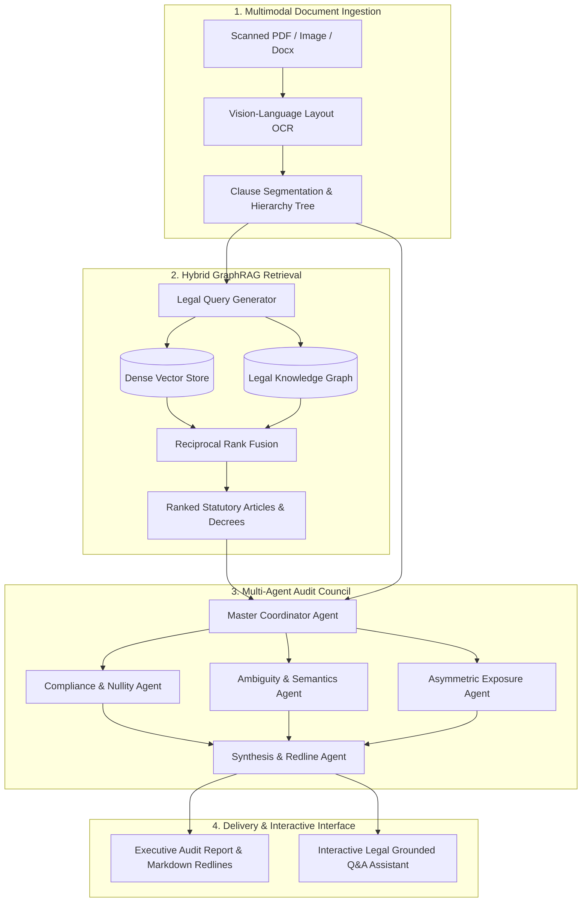

<div align="center">

# 🛡️ LexiGuard
### Autonomous Multi-Agent Contract Vulnerability Auditing & Legal Cross-Referencing System
**Powered by Multimodal Document OCR, Hybrid GraphRAG & Multi-Agent Orchestration**

[](https://www.python.org/)
[](#system-architecture)
[-green.svg)](#hybrid-graphrag-engine)
[](https://deepmind.google/technologies/gemini/)
[](LICENSE)

[**Key Rationale**](#the-core-philosophy) •
[**3 Killer Features**](#-the-3-crown-jewel-capabilities-beyond-generic-chatbots) •
[**The 3 Audit Pillars**](#-the-three-pillars-of-contract-vulnerability) •
[**Enterprise Value**](#-enterprise-business-value--roi) •
[**System Architecture**](#️-system-architecture) •
[**Technical Docs**](docs/README.md) •
[**Quick Start**](#-getting-started) •
[**Roadmap**](#-roadmap)

---

</div>

## 📌 Executive Summary

**LexiGuard** is an enterprise-grade LegalTech AI platform designed to automate the contract review lifecycle. By ingesting complex commercial contracts, employment agreements, and corporate bylaws (scanned PDFs, images, or native documents), LexiGuard performs clause-by-clause legal cross-referencing against statutory law and regulatory frameworks.

Leveraging **High-Precision Multimodal OCR**, a **Hybrid GraphRAG** engine (combining structured Legal Knowledge Graphs with dense vector embeddings), and an **Ensemble of Autonomous Verification Agents**, LexiGuard pinpoints unlawful clauses, linguistic ambiguities, and asymmetric liabilities—transforming days of tedious manual legal vetting into minutes of verifiable, actionable audit intelligence.

---

## 💡 The Core Philosophy: Why Target "Contract Vulnerabilities vs. Statutory Law"?

A foundational design decision of LexiGuard is its explicit focus on **auditing private contracts against governing statutory law**, rather than attempting to detect "loopholes in sovereign legislation."

```
┌────────────────────────────────────────────────────────────────────────┐
│                   THE ARCHITECTURAL DICHOTOMY                          │
├───────────────────────────────────┬────────────────────────────────────┤
│ ❌ "Gaps in Sovereign Law"        │ ✅ "Contract Auditing vs. Law"     │
├───────────────────────────────────┼────────────────────────────────────┤
│ • Unbounded, macro-level domain   │ • Bounded, deterministic problem   │
│ • Political & legislative intent  │ • Concrete contractual obligations │
│ • Prone to high LLM hallucination │ • Direct statutory cross-check     │
│ • No immediate business utility   │ • High ROI, immediate enterprise   │
│                                   │   risk mitigation & cost savings   │
└───────────────────────────────────┴────────────────────────────────────┘
```

### 1. Macro-Legislative Ambiguity vs. Deterministic Grounding
Sovereign legal codes (such as Commercial Codes, Civil Codes, and Labor Regulations) are drafted with broad, macroeconomic foresight. Identifying a "loophole" in government legislation requires legislative policy analysis and sociological context. For Large Language Models (LLMs), attempting to critique the law itself leads to unbounded reasoning paths, speculation, and high hallucination rates.

### 2. High-Value, Verifiable Contractual Boundary
Contracts, bylaws, and service agreements represent **finite, legally binding private pacts** governed by mandatory public statutes. When an enterprise uploads a 50-page vendor contract, the problem space is crisp, deterministic, and verifiable:
- *Does Clause 8.2 violate statutory caps on liquidated damages?*
- *Is the termination clause missing mandatory cure-period notices?*
- *Are warranty disclaimers legally enforceable under governing consumer protection laws?*

By grounding LLMs on **statutory articles as source-of-truth benchmarks**, LexiGuard eliminates speculative reasoning and delivers mathematically reproducible compliance checks.

---

## 💎 The 3 Crown-Jewel Capabilities: Beyond Generic Chatbots

Traditional LLMs provide lengthy, vague paragraphs of conversational text that legal teams cannot operationalize. LexiGuard is purpose-built with **three high-precision, enterprise-grade capabilities**:

```
┌─────────────────────────────────────────────────────────────────────────────────────────┐
│                               LEXIGUARD CROWN JEWELS                                    │
├───────────────────────────────┬─────────────────────────────┬───────────────────────────┤
│ 1. Playbook Deviation &       │ 2. Automated Redlining &    │ 3. Anti-Hallucination     │
│    Structured Risk Scoring    │    Direct Legal Drafting    │    Citation Traceability  │
├───────────────────────────────┼─────────────────────────────┼───────────────────────────┤
│ • Structured tabular audit    │ • Ready-to-use drop-in      │ • Exact PDF page & line   │
│ • Clause-by-clause breakdown  │   amendment clauses         │   bounding-box metadata   │
│ • High / Medium / Low tiers   │ • Statutory-backed diffs    │ • Neo4j / Qdrant citations│
└───────────────────────────────┴─────────────────────────────┴───────────────────────────┘
```

### 1. 📊 Playbook Deviation Analysis & Risk Scoring (*Phân tích sai lệch & Chấm điểm rủi ro*)
Instead of verbose, conversational paragraphs, LexiGuard parses the contract into an actionable, structured audit matrix. Every single clause is assessed against standard corporate legal playbooks and assigned a clear, standardized severity tier:

* 🔴 **HIGH RISK (`CRITICAL`)**: Unlawful or void provisions (*Trái luật / Vô hiệu*) breaching statutory limits, lacking mandatory provisions, or exposing the company to regulatory invalidation.
* 🟡 **MEDIUM RISK (`WARNING`)**: Drafting loopholes, open-ended timelines, or semantic ambiguities (*Lỗ hổng câu chữ / Mơ hồ*) that a counterparty could exploit to evade contractual liability.
* 🟢 **LOW RISK (`COMPLIANT`)**: Valid, balanced, and commercially standard clauses (*An toàn / Hợp chuẩn*).

#### 📋 Structured Audit Matrix Example
| Clause ID | Clause Heading | Contract Excerpt | Risk Tier | Vulnerability Classification | Violation / Risk Summary |
| :---: | :--- | :--- | :---: | :--- | :--- |
| **Sec 9.4** | Liquidated Damages | *"Penalty of 20% of total Agreement Value for any delivery delay..."* | 🔴 **HIGH** | Statutory Breach (Void) | Violates Article 301, Commercial Law 2005 (Mandatory 8% cap on breach penalties). |
| **Sec 5.2** | Deposit Refund | *"Party A shall refund the security deposit after handover is finished..."* | 🟡 **MEDIUM** | Drafting Ambiguity (Exploitable) | No maximum deadline for refund; exposes Party B to capital lock-in and liquidity risk. |
| **Sec 14.1**| Dispute Resolution | *"Disputes shall be submitted to VIAC in Ho Chi Minh City..."* | 🟢 **LOW** | Compliant (Enforceable) | Clear arbitral forum, designated rules, and enforceable jurisdiction. |

---

### 2. ✍️ Automated Redlining & Direct Legal Drafting (*Đề xuất sửa câu chữ trực tiếp*)
Most legal AI tools stop at diagnosing problems (e.g., stating *"Clause 5.2 fails to specify a refund deadline, risking capital lock-in"*), leaving the lawyer to manually draft a fix. 

**LexiGuard's Redline Agent generates ready-to-negotiate, drop-in replacement clauses** complete with diff blocks and legal justification grounded in statutory law:

#### 📝 Example: Instant Contract Redline Output
> **Identified Vulnerability:** Section 5.2 fails to establish a binding timeline for deposit restitution, allowing Party A to withhold funds indefinitely without triggering default.

```diff
- Section 5.2. Deposit Return: Party A shall return the entire security deposit to Party B after the premises handover inspection is finished.
+ Section 5.2. Deposit Return: Party A shall refund 100% of the security deposit to Party B within seven (07) business days following the mutual execution of the handover acceptance minute. In the event Party A fails to refund within the stipulated timeline, Party A shall pay late-payment interest on the overdue sum calculated at the default interest rate under Article 357 and Article 468 of the 2015 Civil Code, without prejudice to Party B's right to claim compensation under Article 328 of the 2015 Civil Code.
```
* **Negotiation Rationale:** Protects cash flow, enforces a strict 7-day cure window, and cites Civil Code Articles 328/357/468 to eliminate pushback during counterparty negotiations.

---

### 3. 🔍 Anti-Hallucination Citation Traceability (*Truy vết trích dẫn chống ảo giác*)
In legal workflows, hallucinated citations or unverified assertions create catastrophic liability. LexiGuard enforces a **Strict Dual-Ended Provenance Protocol**—no finding is rendered without bidirectional metadata linking the physical document directly to the statutory database:

```
┌───────────────────────────────────────┐          ┌───────────────────────────────────────┐
│       CONTRACT INPUT PROVENANCE       │          │       STATUTORY KNOWLEDGE BASE        │
├───────────────────────────────────────┤          ├───────────────────────────────────────┤
│ • File: Commercial_Lease_2026.pdf     │  Audit   │ • DB: Neo4j Legal Knowledge Graph     │
│ • Page: 8, Lines: 14 – 22             │  Proof   │ • Node: Civil_Code_2015 -> Art_328    │
│ • Bounding Box: [72.0, 312.4, 510.5]  │ ◄──────► │ • Vector: Qdrant Point UUID #8f3d1    │
│ • Hash: sha256:7b91c...e84a           │          │ • Legal Text: Article 328, Clause 2   │
└───────────────────────────────────────┘          └───────────────────────────────────────┘
```

#### 🏷️ Rich Metadata Payload per Finding
```json
{
  "finding_id": "LG-2026-VULN-0042",
  "clause_reference": "Section 5.2 (Deposit Return)",
  "contract_provenance": {
    "source_file": "Commercial_Lease_Agreement_Final.pdf",
    "page_number": 8,
    "line_range": "14-22",
    "bounding_box": {"x0": 72.0, "y0": 312.4, "x1": 510.5, "y1": 368.2},
    "verbatim_text": "Party A shall return the entire security deposit to Party B after the premises handover inspection is finished."
  },
  "legal_grounding": {
    "statute_title": "Civil Code of Vietnam (Law No. 91/2015/QH13)",
    "article": "Article 328 (Deposit)",
    "clause": "Clause 2",
    "database_sources": {
      "neo4j_node_id": "STATUTE:VN:CC2015:ART328:C2",
      "qdrant_point_id": "8f3d1b90-4a8e-42c2-b715-e018d6a894fc",
      "retrieval_similarity_score": 0.942
    }
  },
  "risk_tier": "MEDIUM",
  "audit_verdict": "Absence of statutory temporal performance milestone creates unilateral liquidity risk."
}
```

---

## 🎯 The Three Pillars of Contract Vulnerability

LexiGuard inspects every draft across three specialized legal vulnerability dimensions:

```
                              ┌───────────────────────────────────┐
                              │     LexiGuard Audit Pillars       │
                              └─────────────────┬─────────────────┘
                                                │
         ┌──────────────────────────────┬───────┴──────────────────────────────┐
         ▼                              ▼                                      ▼
┌────────────────────────┐   ┌────────────────────────┐   ┌────────────────────────┐
│   1. Compliance &      │   │ 2. Drafting Ambiguities│   │  3. Asymmetric Risk    │
│      Nullity Check     │   │    & Exploitation      │   │     & Exposure         │
├────────────────────────┤   ├────────────────────────┤   ├────────────────────────┤
│ • Mandatory law breaches│  │ • Unbounded quantifiers│   │ • One-sided penalties  │
│ • Automatically void   │   │ • Unclear timelines    │   │ • Skewed indemnities   │
│   clauses              │   │ • Loose Force Majeure  │   │ • Unilateral rights of │
│ • Regulatory fines     │   │ • Loophole exploitation│   │   termination          │
└────────────────────────┘   └────────────────────────┘   └────────────────────────┘
```

### 1. Statutory Compliance & Nullity Check (*Điều khoản trái luật / vô hiệu*)
Identifies provisions that breach imperative legal statutes, rendering them null, void, or subject to administrative penalties:
- **Liquidated Damages Caps**: Flags penalties exceeding statutory ceilings (e.g., Article 301 of Vietnam's Commercial Law capping breach penalties at 8% of the breached obligation value).
- **Labor Code Violations**: Catches unauthorized wage withholding, excessive probationary periods, or unlawful non-compete covenants that infringe upon statutory employee rights.
- **Consumer & Data Protection**: Pinpoints mandatory disclosure omissions and GDPR/PDPA compliance failures.

### 2. Drafting Ambiguities & Semantic Loopholes (*Lỗ hổng chữ nghĩa / Từ ngữ mơ hồ*)
Detects vague language, undefined qualifiers, and open-ended obligations that counterparties can weaponize to evade liability:
- **Indefinite Quantifiers**: Flags phrases such as *"reasonable efforts"*, *"promptly"*, *"acceptable standard"*, or *"material impact"* where strict numerical metrics or deadlines are required.
- **Omission of Fallback Conditions**: Detects incomplete dispute escalations, silent governing laws, and ambiguous delivery milestones.
- **Weaponized Force Majeure**: Uncovers overly broad pandemic, economic slowdown, or governmental intervention clauses drafted to excuse non-performance.

### 3. Asymmetric Risk & Unbalanced Liabilities (*Điểm yếu bất lợi / Rủi ro bất cân xứng*)
Performs an adversarial red-team assessment of reciprocal rights and duties:
- **Unbalanced Penalty Structures**: Detects contracts mandating hefty late-payment penalties on Party B while remaining completely silent on sanctions if Party A delays milestones or approvals.
- **One-Sided Indemnification**: Highlights uncapped liability on the vendor with zero reciprocal indemnification from the buyer.
- **Unilateral Termination Power**: Identifies termination-for-convenience clauses reserved exclusively for one party without equitable notice or compensation mechanisms.

---

## 💼 Enterprise Business Value & ROI

For corporate legal departments, procurement teams, and law firms, contract review is an expensive operational bottleneck. LexiGuard delivers tangible enterprise impact:

| Metric | Traditional Legal Review | LexiGuard Automated Pipeline | Enterprise Impact |
| :--- | :--- | :--- | :--- |
| **Review Turnaround Time** | 2 – 5 Business Days | **< 60 Seconds** per 30-page contract | **98% reduction** in review latency; accelerates deal velocity. |
| **Direct Review Costs** | $300 – $700+ / hour (External counsel) | **Fraction of a cent** per page | **Up to 80% reduction** in routine document auditing expenditure. |
| **Omission / Human Error Rate** | Variable (Fatigue-prone across 100+ pages) | **Deterministic & Systematic** | Exhaustive cross-referencing against all relevant statutory articles. |
| **Negotiation Leverage** | Ad-hoc counter-proposals | **Automated Redlines & Legal Justifications** | Generates instant, citation-backed counter-amendments for negotiations. |
| **Institutional Knowledge** | Siloed in individual senior counsel | **Centralized Legal Knowledge Graph** | Standardizes corporate risk appetite across global procurement teams. |

---

## 🏗️ System Architecture

LexiGuard fuses multimodal vision models, knowledge graphs, and multi-agent systems into a streamlined workflow:



### 🧠 The Core Technological Innovations

#### 1. Multimodal Document Ingestion & Layout-Aware OCR
Legal documents are rarely clean plain text; they arrive as skewed scans, stamps, multi-column layouts, and nested annexes.
- **Vision-Language Parsing**: Converts scanned documents into markdown hierarchies, preserving clause numbering (`1.1.2`, `Article 4(a)`), signatures, and tabular data.
- **Syntactic Tree Construction**: Builds a parsed syntax tree where each clause inherits scope, parties, and governing definitions.

#### 2. Hybrid GraphRAG Engine (Knowledge Graph + Dense Vectors)
Standard vector RAG fails on legal texts because legal statutes are hierarchical, cross-referential, and codependent (e.g., *Article 12 refers to Article 5 of Decree 13/2023/ND-CP*).
- **Legal Knowledge Graph (KG)**: Nodes represent Codes, Decrees, Circulars, Articles, and Precedents; edges map hierarchical relations (`CONTAINS`), amendments (`SUPERSEDES`), and cross-statute dependencies (`REFERENCES`).
- **Dense Vector Embeddings**: Encodes semantic nuances of contractual clauses.
- **Dual-Path Fusion**: Simultaneously traverses the Knowledge Graph for strict statutory dependencies while vector search retrieves semantically similar legal precedents.

#### 3. Autonomous Multi-Agent Audit Council
Rather than relying on a single monolithic prompt, LexiGuard deploys specialized, role-isolated LLM agents:
- **Compliance & Nullity Agent**: Cross-references clauses against mandatory prohibitions; calculates statutory cap breaches.
- **Ambiguity & Semantics Agent**: Stress-tests wording for loopholes, missing temporal milestones, and vague obligations.
- **Asymmetric Exposure Agent**: Assesses the balance of power between contracting parties and highlights unilateral exposures.
- **Synthesis & Redline Agent**: Reconciles findings, scores contract health (0–100), and produces track-changes redline amendments with legal rationale.
- **Interactive Legal Q&A Agent**: A grounded conversational copilot that cites specific statutory articles and document clauses with zero hallucination.

---

## 📂 Repository Structure

```plaintext
LexiGuard/
├── .github/                      # GitHub Actions CI/CD workflows
│   └── workflows/
│       └── ci.yml                # Automated pipeline: Ruff linter & Pytest on Push/PR
├── docker-compose.yml             # Orchestration: FastAPI, Qdrant, Neo4j, and Langfuse
├── Dockerfile                     # High-performance multi-stage build powered by uv
├── pyproject.toml                 # Dependencies & tool configurations (uv, ruff, pytest)
├── requirements.txt               # Production Python dependencies
├── .env.example                   # Environment configuration template
├── README.md                      # Architecture, benchmarks, and project documentation
│
├── docs/                          # Detailed subsystem technical specifications & architecture docs
│   ├── README.md                  # Documentation index across all 5 development phases
│   ├── 01_ocr_and_vision_pipeline.md # Two-Branch OCR (Docling + Two-Stage CPU VietOCR + Decree 30 R-XYCut)
│   └── 01_data_schema_and_hierarchical_graph_ingestion.md # Pydantic v2 Schema, Chunker & Neo4j Triples
│
├── data/
│   ├── raw_laws/                  # Statutory legal corpus (Labor Code 2019, Civil Code 2015)
│   ├── sample_contracts/          # Benchmark contracts with deliberate legal traps
│   └── eval_dataset/
│       └── golden_qa_contracts.json # 25 Ground-truth legal QA test cases for RAGAS evaluation
│
├── scripts/
│   ├── ingest_laws.py             # Docling parser -> Hierarchical chunking -> Qdrant & Neo4j
│   └── run_evaluation.py          # RAGAS evaluation runner with Markdown/CSV metrics export
│
├── src/
│   ├── core/
│   │   ├── config.py              # Pydantic BaseSettings environment management
│   │   ├── schemas.py             # Pydantic v2 Core Legal AST, Chunks & Graph Schemas
│   │   └── logging.py             # Structured JSON logging & Langfuse tracing integration
│   │
│   ├── ingestion/
│   │   ├── image_preprocessor.py  # Multi-page collage splitting & Lanczos4 + CLAHE enhancement
│   │   ├── docling_parser.py      # IBM Docling layout & TableFormer table extraction
│   │   ├── decree30_xycut.py      # Decree 30/2020 Spatial Zones Map & Recursive XY-Cut Engine
│   │   ├── two_stage_ocr.py       # CPU Two-Stage OCR (PaddleOCR DBNet++ + VietOCR Transformer)
│   │   ├── ocr_engine.py          # Quality Assessment Gate & Two-Branch OCR Orchestrator
│   │   ├── legal_chunker.py       # Chapter -> Article -> Clause syntax segmentation
│   │   └── graph_extractor.py     # Cross-statutory relation extractor (Neo4j triples)
│   │
│   ├── retrieval/
│   │   ├── qdrant_store.py        # Qdrant Hybrid Search (bge-m3 Dense + BM25 Sparse)
│   │   ├── neo4j_store.py         # Multi-hop Cypher traversal for statutory dependencies
│   │   └── hybrid_retriever.py    # Reciprocal Rank Fusion + Neural Cross-Encoder Reranker
│   │
│   ├── mcp_server/
│   │   └── legal_tools.py         # FastMCP Server providing search_law & get_related_articles
│   │
│   ├── agents/
│   │   ├── state.py               # TypedDict AgentState & Pydantic audit report schemas
│   │   ├── prompts.py             # Role-isolated prompts for Extractor, Auditor, and Verifier
│   │   ├── nodes.py               # Execution logic of individual agent nodes
│   │   └── workflow.py            # LangGraph StateGraph compilation
│   │
│   ├── api/
│   │   ├── main.py                # FastAPI entry point, CORS, and connection pool lifespan
│   │   └── routes/
│   │       ├── health.py          # Service dependency health check (/health)
│   │       └── audit.py           # Contract upload & audit report via SSE Streaming
│   │
│   └── ui/
│       └── chainlit_app.py        # Interactive legal copilot & PDF report viewer
│
└── tests/
    ├── test_chunker.py            # Unit tests for legal hierarchy segmentation
    ├── test_retriever.py          # Integration tests for Qdrant and Neo4j retrieval
    └── test_api.py                # Asynchronous API endpoint tests via httpx
```

---

## 🚀 Getting Started

### Prerequisites
- Python 3.10 or higher
- Docker & Docker Compose (for Neo4j and Vector Database)
- An active API key for Google Gemini (`GEMINI_API_KEY`) or preferred LLM provider

### 1. Clone the Repository
```bash
git clone https://github.com/hotrungtruc/LexiGuard.git
cd LexiGuard
```

### 2. Environment Setup
```bash
# Create and activate virtual environment
python -m venv venv
source venv/bin/activate  # On Windows: .\venv\Scripts\activate

# Install dependencies
pip install -r requirements.txt
```

### 3. Launch Knowledge Graph & Vector Store
```bash
docker-compose -f docker/docker-compose.yml up -d
```

### 4. Configure Secrets
Create a `.env` file in the root directory:
```env
# LLM Providers
GEMINI_API_KEY="your-google-gemini-api-key"

# Knowledge Graph (Neo4j)
NEO4J_URI="bolt://localhost:7687"
NEO4J_USERNAME="neo4j"
NEO4J_PASSWORD="lexiguard_secure_password"

# Vector Database (Qdrant)
QDRANT_URL="http://localhost:6333"
QDRANT_API_KEY="your-qdrant-api-key"
QDRANT_COLLECTION="legal_statutes_corpus"
EMBEDDING_MODEL="text-embedding-004"
```

### 5. Run the Audit Engine CLI
Audit an existing contract draft with one command:
```bash
python -m src.api.main --audit examples/sample_commercial_contract.pdf \
                       --jurisdiction VN \
                       --output reports/sample_audit_report.md
```

### 6. Start the Web & API Service
```bash
uvicorn src.api.main:app --host 0.0.0.0 --port 8000 --reload
```
Navigate to `http://localhost:8000/docs` to explore interactive Swagger API endpoints for:
- `/api/v1/ingest`: Upload and OCR scan contracts
- `/api/v1/audit`: Run full multi-agent vulnerability assessment
- `/api/v1/redline`: Generate track-changes counter-proposals
- `/api/v1/chat`: Converse with the grounded Legal Q&A Agent

---

## 📊 Example Audit Output

When LexiGuard analyzes a high-risk clause, it generates structured, citation-grounded findings:

<details open>
<summary><b>🔍 Sample Audit Finding: Liquidated Damages Statutory Breach</b></summary>

```markdown
### ⚠️ HIGH RISK: Unlawful Liquidated Damages Provision (Statutory Cap Breach)

- **Clause Reference:** Section 9.4 (Penalties & Default), Page 14
- **Original Text:**
  > *"In the event of any delivery delay by the Supplier, the Supplier shall pay a fixed penalty of 20% of the total Agreement Value."*

- **Vulnerability Category:** Statutory Non-Compliance / Void Clause
- **Governing Law Cross-Reference:** Article 301, Vietnam Commercial Law 2005 (Luật Thương Mại 2005)
- **Legal Analysis:**
  Article 301 mandates that the total penalty for breach of contract obligations cannot exceed 8% of the value of the breached obligation (excluding foreign-related maritime exceptions). The 20% flat penalty is unlawful and judicially unenforceable.

- **Asymmetric Exposure Detected:**
  Contract contains no corresponding penalty or interest compensation if the Purchaser delays payment or milestone sign-off.

- **Recommended Redline (Proposed Amendment):**
  ```diff
  - In the event of any delivery delay by the Supplier, the Supplier shall pay a fixed penalty of 20% of the total Agreement Value.
  + In the event of any delivery delay attributable solely to the Supplier, the Supplier shall pay a late-delivery penalty of 1.0% per week of the delayed portion's value, provided that the total cumulative penalty shall not exceed 8.0% of the breached contractual obligation value, in strict compliance with Article 301 of the Commercial Law.
  ```
</details>

---

## 🗺️ Product Roadmap

- [x] **Phase 1**: High-fidelity multimodal OCR pipeline for scanned legal agreements.
- [x] **Phase 2**: Dual-channel Hybrid GraphRAG architecture (Statutory Knowledge Graph + Vector DB).
- [x] **Phase 3**: Autonomous Multi-Agent Council (Compliance, Ambiguity, Asymmetry, and Redline Agents).
- [ ] **Phase 4**: Interactive Web UI with side-by-side DOCX/PDF track-changes viewer.
- [ ] **Phase 5**: Multi-jurisdiction legal expansion (Vietnam, Singapore, Delaware/US, EU GDPR).
- [ ] **Phase 6**: Enterprise ERP/CLM integration (Salesforce, SAP, Ironclad, DocuSign).

---

## ⚖️ Legal Disclaimer

> **IMPORTANT NOTICE:** LexiGuard is an artificial intelligence research platform designed to assist and augment professional legal workflows. **LexiGuard does not provide formal legal advice, nor does its output establish an attorney-client relationship.** While LexiGuard cross-references documents against statutory laws with high precision, all generated audits, redlines, and assessments must be reviewed and approved by certified legal counsel before execution in commercial transactions.

---

## 📄 License

This project is licensed under the Apache 2.0 License - see the [LICENSE](LICENSE) file for details.

---

<div align="center">
<sub>Crafted with engineering rigor for the future of Autonomous Enterprise Legal Operations.</sub>
</div>
