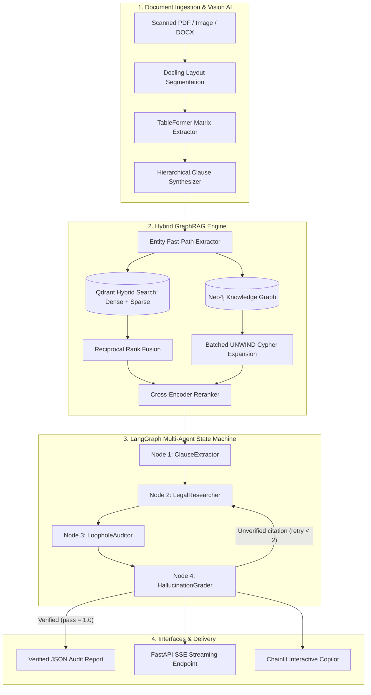

# LexiGuard

### Autonomous Multi-Agent Contract Auditing and Legal Cross-Referencing System
**Enterprise contract risk analysis powered by layout-aware document ingestion, hybrid GraphRAG, and self-correcting multi-agent orchestration.**

[](https://www.python.org/)
[](LICENSE)
[](docs/04_fastmcp_multiagent_langgraph.md)
[](docs/03_hybrid_graphrag_qdrant_neo4j.md)
[-brightgreen.svg)](reports/VLEGAL_BENCHMARK_REPORT.md)

[Executive Summary](#executive-summary) |
[Core Architectural Principle](#core-architectural-principle) |
[Key Capabilities](#key-capabilities) |
[System Architecture](#system-architecture) |
[Empirical Benchmarks](#empirical-benchmarks) |
[Repository Structure](#repository-structure) |
[Quickstart](#quickstart) |
[API Reference](#api-reference) |
[Documentation](#technical-documentation) |
[Legal Disclaimer](#legal-disclaimer)

---

## Executive Summary

LexiGuard is an enterprise LegalTech platform engineered to automate the contract review lifecycle. When organizations execute commercial contracts, service agreements, employment contracts, and corporate bylaws, manual clause-by-clause vetting against statutory laws is slow, error-prone, and expensive.

LexiGuard ingests complex native and scanned documents (PDF, DOCX, images) and performs clause-by-clause legal cross-referencing against sovereign legislation. The system combines:

1. **Multimodal Document Layout Parsing**: Structural segmentation preserving article numbering, indentation, tables, and spatial bounding boxes.
2. **Hybrid GraphRAG**: Simultaneous dense vector retrieval (Qdrant) and deterministic knowledge graph traversal (Neo4j) to capture hierarchical statutory structures and cross-code amendments.
3. **Autonomous Multi-Agent Orchestration**: A cyclic, self-correcting state machine (LangGraph) that inspects clauses, audits financial table arithmetic, drafts statutory redlines, and enforces anti-hallucination citation verification.

---

## Core Architectural Principle

### Bounded Contract Auditing vs. Unbounded Legal Speculation

A foundational design tenet of LexiGuard is its strict focus on **auditing private contractual provisions against governing statutory baselines**, rather than attempting ungrounded policy analysis of sovereign legislation:

| Dimension | Speculative Legal Critique | Grounded Contract Auditing (LexiGuard) |
| :--- | :--- | :--- |
| **Problem Scope** | Unbounded macro-policy reasoning | Bounded, deterministic statutory compliance |
| **Truth Grounding** | Subjective, speculative, open-ended | Explicit statutory articles, caps, and mandatory clauses |
| **Model Hallucination** | High risk of hallucinated doctrine | Controlled via exact bidirectional database citations |
| **Enterprise Utility** | Theoretical policy commentary | Immediate risk reduction, automated redlines, and ROI |

By anchoring large language models to statutory articles stored in verified knowledge graphs and vector databases, LexiGuard transforms contract vetting into a deterministic, verifiable workflow.

---

## Key Capabilities

### 1. Structured Risk Scoring and Playbook Deviation

LexiGuard decomposes agreements into an actionable audit matrix. Every clause is assessed and classified into standardized severity tiers:

- **Critical (High Risk)**: Provisions that violate mandatory statutory rules, render a clause null and void, or expose the entity to regulatory penalties (e.g., liquidated damages exceeding statutory limits).
- **Warning (Medium Risk)**: Drafting ambiguities, open-ended deadlines, or asymmetric obligations that counterparties can exploit.
- **Compliant (Low Risk)**: Balanced, enforceable, and standard provisions aligned with corporate playbooks.

### 2. Automated Redlining and Direct Legal Drafting

Beyond diagnosing defects, LexiGuard produces ready-to-negotiate replacement clauses with diff blocks and legal justifications grounded in governing statutes:

```diff
- Section 5.2. Deposit Return: Party A shall return the entire security deposit to Party B after the premises handover inspection is finished.
+ Section 5.2. Deposit Return: Party A shall refund 100% of the security deposit to Party B within seven (07) business days following mutual execution of the handover acceptance minute. In the event Party A fails to refund within this timeline, Party A shall pay late-payment interest on the overdue sum under Articles 357 and 468 of the Civil Code 2015, without prejudice to Party B's right to compensation under Article 328 of the Civil Code 2015.
```

### 3. Dual-Ended Provenance and Citation Verification

To prevent hallucinated citations, every finding links document coordinates to statutory database identifiers:

- **Document Source Provenance**: File name, page number, line range, and spatial bounding box coordinates `[x0, y0, x1, y1]`.
- **Statutory Authority Grounding**: Neo4j node ID, Qdrant point UUID, official law title, article number, and verbatim legislative text.

### 4. Deterministic Table Arithmetic Auditing

Financial annexes and compensation schedules are audited deterministically:
- Row-level multiplication (Quantity x Unit Price).
- Column-level summations and discount calculations.
- Value Added Tax (VAT) rate verification against statutory tax schedules.

---

## System Architecture

LexiGuard integrates four specialized subsystems into an asynchronous pipeline:



### Subsystem Breakdown

1. **Multimodal Document AI (`src/ingestion`)**:
   - Layout parsing using IBM Docling and DocLayNet to isolate chapters, articles, clauses, and schedules.
   - Coordinate-aware bounding box preservation for visual provenance.
   - Memory-safe batch slicing (`pypdfium2`) to process high-page legal gazettes without GPU memory overflow.

2. **Hybrid GraphRAG Engine (`src/retrieval`)**:
   - **Qdrant Vector Store**: Dense semantic embeddings (`BAAI/bge-m3` or `text-embedding-004`) combined with sparse token search via Reciprocal Rank Fusion.
   - **Neo4j Knowledge Graph**: Explicit structural containment (`CONTAINS`) and cross-statutory citations (`REFERENCES`, `EXCEPTION_TO`, `CITES_CLAUSE`, `SUPERSEDES`).
   - **Batched UNWIND Traversal**: Executes multi-hop graph expansions in a single roundtrip, reducing expansion latency by 66%.
   - **Cross-Encoder Reranking**: Re-scores top candidates using `bge-reranker-v2-m3` for high precision.

3. **Multi-Agent State Machine (`src/agents`)**:
   - Four specialized nodes: `ClauseExtractor`, `LegalResearcher`, `LoopholeAuditor`, and `HallucinationGrader`.
   - Tool calling via FastMCP (`search_legal_provisions`, `get_article_graph_context`, `verify_table_arithmetic`).
   - Self-reflective loop: findings with ungrounded statutory citations are rejected and routed for automatic re-querying.

4. **API and User Interface (`src/api`, `src/ui`)**:
   - Production FastAPI service with Server-Sent Events (SSE) streaming.
   - Interactive Chainlit web copilot with side-by-side contract view.

---

## Empirical Benchmarks

LexiGuard has been evaluated on rigorous legal benchmarks to validate retrieval precision, conflict detection accuracy, and citation grounding.

### 1. VLegal-Bench Evaluation (CMC-OPENAI/VLegal-Bench)

Evaluated on 492 real-world Vietnamese legal samples focusing on core operational tasks:

| Evaluation Objective | Task ID | Sample Size | Primary Metric | Result | System Significance |
| :--- | :---: | :---: | :--- | :---: | :--- |
| **Conflict & Consistency Detection** | Task 3.4 | 166 pairs | Accuracy<br>Conflict Precision<br>Conflict Recall<br>Conflict F1 | **95.18%**<br>**97.56%**<br>**96.00%**<br>**0.9677** | Validates the LoopholeAuditor engine in detecting unlawful local decrees against national statutes with near-zero false alarms. |
| **Legal Knowledge Graph Structuring** | Task 2.3 | 326 samples | Correct Triplets<br>Graph Precision<br>Graph F1<br>Exact Sample Match | **89 triplets**<br>**26.02%**<br>**0.1958**<br>**9.20%** | Validates automated extraction of `(Entity 1, Legal Relation, Entity 2)` triplets for populating the Neo4j GraphRAG database. |

Confusion Matrix for Task 3.4 (Conflict Detection):
```
                        PREDICTED
                   Conflict       No Conflict
ACTUAL Conflict      120 (TP)          5 (FN)
    No Conflict        3 (FP)         38 (TN)
```

Full benchmark details and reproduction logs are in [reports/VLEGAL_BENCHMARK_REPORT.md](reports/VLEGAL_BENCHMARK_REPORT.md).

### 2. Multi-Year Statutory Retrieval Benchmark (ALQAC)

Evaluated on the Automated Legal Question Answering Competition datasets:
- Robust multi-hop retrieval over Civil and Commercial statutes.
- Evaluated across BM25 lexical search, dense embeddings, Reciprocal Rank Fusion, and Cross-Encoder reranking.
- Comprehensive evaluation reports: [reports/ALQAC_MASTER_BENCHMARK_REPORT.md](reports/ALQAC_MASTER_BENCHMARK_REPORT.md).

### 3. Deterministic Evaluator Suite

- 100% pass rate across deterministic test suites covering table arithmetic, payload index routing, and hallucination guardrails (`pytest tests/test_vlegal_evaluator.py`).

---

## Repository Structure

```plaintext
LexiGuard/
|-- docker-compose.yml          # Container orchestration (Neo4j, Qdrant, FastAPI)
|-- Dockerfile                  # Container build specification
|-- pyproject.toml              # Project dependencies and tool configurations
|-- requirements.txt            # Python dependencies
|-- README.md                   # Project overview and system specification
|
|-- docs/                       # Technical specifications and architecture guides
|   |-- README.md               # Documentation index and architecture overview
|   |-- 01_ocr_and_vision_pipeline.md
|   |-- 02_data_schema_and_hierarchical_graph_ingestion.md
|   |-- 03_hybrid_graphrag_qdrant_neo4j.md
|   |-- 04_fastmcp_multiagent_langgraph.md
|   `-- assets/                 # Architecture diagrams and topology visualizations
|
|-- data/
|   |-- raw_laws/               # Official statutory gazette PDFs (Civil Code, Labor Code)
|   |-- extracted_laws/         # Generated ASTs, chunks, and Neo4j Cypher imports
|   |-- court_judgments/        # Precedents and judicial rulings
|   `-- vlegal_bench/           # VLegal-Bench task evaluation datasets
|
|-- src/
|   |-- core/                   # Configuration, schemas, hardware tuning, logging
|   |-- ingestion/              # Docling parser, chunker, graph extractor
|   |-- retrieval/              # Qdrant store, Neo4j store, hybrid retriever, BM25
|   |-- mcp_server/             # FastMCP tools (search_legal_provisions, math audit)
|   |-- agents/                 # LangGraph nodes, prompts, state definitions, workflow
|   |-- evaluation/             # Evaluator suites for VLegal-Bench and ALQAC
|   |-- api/                    # FastAPI routes (audit, ingest, health)
|   `-- ui/                     # Chainlit web copilot application
|
|-- scripts/
|   |-- run_vlegal_benchmark.py # VLegal-Bench execution runner
|   |-- run_alqac_benchmark.py  # ALQAC benchmark runner
|   |-- ingest_laws.py          # Statutory corpus ingestion CLI
|   `-- reset_databases.py      # Database wipe and schema initializer
|
|-- reports/                    # Generated benchmark and evaluation reports
`-- tests/                      # Unit and integration test suites
```

---

## Quickstart

### Prerequisites

- Python 3.11 or higher
- Docker and Docker Compose
- GPU with CUDA support recommended (CPU fallback supported)
- Gemini API key or Ollama local LLM

### 1. Clone and Install Dependencies

```bash
git clone https://github.com/hotrungtruc/LexiGuard.git
cd LexiGuard

# Create and activate virtual environment
python -m venv venv
# Linux/macOS:
source venv/bin/activate
# Windows PowerShell:
.\venv\Scripts\Activate.ps1

# Install dependencies
pip install -r requirements.txt
```

### 2. Start Supporting Infrastructure

Launch Qdrant Vector DB and Neo4j Graph DB:

```bash
docker-compose up -d
```

Verify services:
- Qdrant UI: `http://localhost:6333/dashboard`
- Neo4j Browser: `http://localhost:7687` (Default user: `neo4j`, password: `lexiguard_secure_password`)

### 3. Configure Environment

Create a `.env` file in the project root:

```env
# LLM Providers
GEMINI_API_KEY="your-gemini-api-key"
LLM_PROVIDER="gemini"
LLM_MODEL="gemini-2.0-flash"

# Neo4j Graph Database
NEO4J_URI="bolt://localhost:7687"
NEO4J_USERNAME="neo4j"
NEO4J_PASSWORD="lexiguard_secure_password"
NEO4J_DATABASE="neo4j"

# Qdrant Vector Database
QDRANT_URL="http://localhost:6333"
QDRANT_COLLECTION="legal_statutes_corpus"
```

### 4. Run the Core Benchmark Suite

Execute the benchmark suite on VLegal-Bench tasks (Task 2.3 and Task 3.4):

```bash
python scripts/run_vlegal_benchmark.py
```

Run unit tests:

```bash
pytest tests/test_vlegal_evaluator.py -v
```

### 5. Start the Web API Server

```bash
uvicorn src.api.main:app --host 0.0.0.0 --port 8000 --reload
```

Interactive OpenAPI documentation is available at `http://localhost:8000/docs`.

---

## API Reference

| Endpoint | Method | Payload | Description |
| :--- | :---: | :--- | :--- |
| `/health` | `GET` | None | Returns operational health status of API, Neo4j, and Qdrant. |
| `/api/v1/audit` | `POST` | `multipart/form-data` (file) | Audits an uploaded contract; returns SSE streaming progress and final JSON. |
| `/api/v1/ingest` | `POST` | `multipart/form-data` (file) | Parses and extracts layout elements and tabular matrices from a document. |
| `/api/v1/redline` | `POST` | JSON `{ clause_text, violation }` | Generates compliant replacement wording with statutory justification. |

---

## Technical Documentation

Detailed subsystem architecture specifications are available in the [docs/](docs/) directory:

- [docs/01_ocr_and_vision_pipeline.md](docs/01_ocr_and_vision_pipeline.md): Layout analysis, TableFormer, and bounding box provenance.
- [docs/02_data_schema_and_hierarchical_graph_ingestion.md](docs/02_data_schema_and_hierarchical_graph_ingestion.md): Pydantic schemas, hierarchical chunking, and Neo4j batch ingestion.
- [docs/03_hybrid_graphrag_qdrant_neo4j.md](docs/03_hybrid_graphrag_qdrant_neo4j.md): 3-stage hybrid retrieval, RRF, and batched Cypher expansion.
- [docs/04_fastmcp_multiagent_langgraph.md](docs/04_fastmcp_multiagent_langgraph.md): 4-node LangGraph state machine, FastMCP tools, and self-reflection gate.

---

## Legal Disclaimer

LexiGuard is an artificial intelligence research and decision-support system. It is designed to augment and assist qualified legal professionals during contract review workflows. **LexiGuard does not provide formal legal advice, and its output does not create an attorney-client relationship.** All audit findings, risk classifications, and proposed redlines should be verified and approved by licensed legal counsel before execution in binding commercial transactions.

---

## License

This project is licensed under the Apache License 2.0. See the [LICENSE](LICENSE) file for complete terms.
