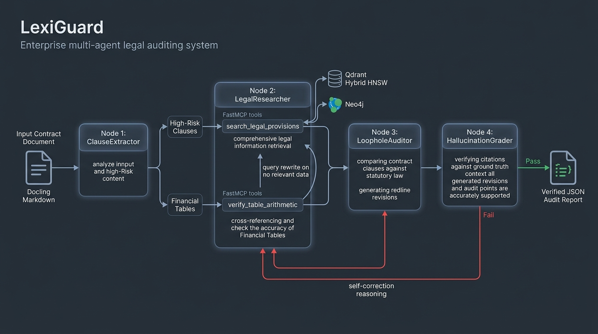

# LexiGuard Multi-Agent Workflow & Self-Correcting State Machine

## Autonomous Legal Auditing, FastMCP Tool Execution, and Self-Reflective StateGraph Orchestration
Powered by LangGraph, FastMCP Server, Qdrant Hybrid HNSW, and Neo4j Knowledge Graph.

---

## 1. Architectural Overview & Design Motivation

### 1.1 Limitations of Linear Naive RAG in Legal Auditing
Traditional retrieval-augmented generation architectures operate in a brittle, linear pipeline:
$$\text{Input Contract Query} \longrightarrow \text{Vector Search} \longrightarrow \text{Direct LLM Response}$$

When applied to commercial contracts and civil statutes, linear RAG fails due to three systemic vulnerabilities:
1. **Zero Self-Reflection**: If initial vector retrieval pulls irrelevant clauses or misses cross-statutory citations, the generator blindly hallucinates or dismisses valid legal grounds.
2. **Tabular Blindness**: Vector models cannot perform mathematical calculations across schedules, fee brackets, and VAT calculations in contract annexes.
3. **Statutory Hallucination**: Generative models frequently invent non-existent statutory articles (e.g., citing a non-existent clause in the Labour Code) without verifying citations against grounded database context.

### 1.2 The LexiGuard Autonomous Multi-Agent State Machine
LexiGuard replaces linear RAG with a cyclic, self-reflective state machine orchestrated by **LangGraph** and powered by **FastMCP Server** tools. The pipeline isolates high-risk clauses, autonomously queries vector and graph datastores, audits financial arithmetic, and enforces citation grounding via an automated hallucination grading loop.



---

## 2. Multi-Agent State Machine Architecture

The multi-agent workflow coordinates state transitions through a typed state container defined in [src/agents/state.py](file:///c:/PROJECTS/LexiGuard/src/agents/state.py).

### 2.1 Agent State Schema (`AgentState`)

| State Field | Data Type | Functional Description | Producing Node |
| :--- | :--- | :--- | :--- |
| `raw_document_path` | String | Path to input scanned PDF or contract file | Workflow Entry |
| `parsed_clauses` | List[Dict] | Extracted high-risk clauses and tabular matrices | `ClauseExtractor` |
| `retrieved_statutes` | List[Dict] | Grounded statutes, clauses, and precedents | `LegalResearcher` |
| `arithmetic_findings`| List[Dict] | Discrepancies from table arithmetic audit | `LegalResearcher` |
| `audit_findings` | List[Dict] | Statutory loophole findings and redline suggestions | `LoopholeAuditor` |
| `hallucination_verdicts` | List[Dict] | Citation accuracy scores and feedback notes | `HallucinationGrader`|
| `retry_count` | Integer | Counter tracking self-correction retry cycles | State Machine |
| `final_report` | Dict | Verified JSON contract audit report | Workflow Exit |

### 2.2 Centralized Hardware Auto-Tuning (`src/core/hardware.py`)
Hardware metrics are never hardcoded. All compute-intensive components (Ollama LLM, Docling OCR, Vector Search) consume compute parameters from a single centralized profile:

| Hardware Dimension | Detection Method | Dynamic Optimization Rule | Host Machine Value |
| :--- | :--- | :--- | :--- |
| **CPU Physical Cores** | `psutil.cpu_count(logical=False)` | Sets `OLLAMA_NUM_THREADS = physical_cores` to avoid SMT thread contention | **10 Physical Cores** |
| **System RAM** | `psutil.virtual_memory().total` | Recommends `OLLAMA_MAX_LOADED_MODELS = 2` if RAM $\ge$ 14GB (Dual-LLM co-residency) | **15.64 GB RAM** |
| **GPU / Accelerator** | `torch.cuda.is_available()` | Selects `"cuda"` if VRAM $\ge$ 2GB for Docling layout parser & embeddings | **RTX 4050 (6GB VRAM)** |
| **OCR Threads** | CPU Topology Inspection | Bounded to $\min(\text{physical\_cores}, 8)$ to reserve headroom for system services | **8 Worker Threads** |

---

## 3. Specialized Agent Nodes

The state graph transitions sequentially across 4 autonomous agents, with conditional branches for self-correction.

### 3.1 Node 1: `ClauseExtractor`
* **Input**: Consolidated semantic Markdown extracted from the input contract via IBM Docling.
* **Responsibilities**:
  - Scans and decomposes contractual clauses into discrete semantic units (Articles, Clauses, Schedules).
  - Isolates clauses exhibiting high vulnerability risk (unilateral termination rights, uncapped liquidated damages, broad indemnification waivers, restrictive covenant clauses).
  - Detects financial and compensation tables, extracting their structured Markdown representation for mathematical auditing.
* **Output**: Populates `parsed_clauses` and tabular annexes in state.

### 3.2 Node 2: `LegalResearcher` (Self-Querying & Autonomous Tool Use)
* **Input**: Extracted high-risk contractual clauses and tabular matrices.
* **Responsibilities**:
  - **Statutory Search**: Calls the FastMCP tool `search_legal_provisions` with automatic self-querying. Inferred filters (`law_id`, `article_num`) query Qdrant Hybrid HNSW with $O(1)$ payload index filters.
  - **Graph Expansion**: Calls `get_article_graph_context` to traverse Neo4j up to 2 hops, retrieving cross-referenced provisions, statutory exceptions, and judicial precedents.
  - **Table Arithmetic Auditing**: Calls `verify_table_arithmetic` to check horizontal row products (quantity $\times$ price), vertical column sums, and VAT percentages across contract schedules.
  - **Query Rewriting Loop**: If initial vector retrieval yields `NO_RELEVANT_DATA` or low semantic similarity (< 0.70), the node reformulates query terminology autonomously and re-executes search.
* **Output**: Populates `retrieved_statutes` and `arithmetic_findings`.

### 3.3 Node 3: `LoopholeAuditor` (Dual-Perspective Adversarial Prompting)
* **Input**: Contract clauses paired with grounded statutory provisions and arithmetic audit findings.
* **Dual-Perspective Cognitive Scaffolding** ([src/agents/prompts.py](file:///c:/PROJECTS/LexiGuard/src/agents/prompts.py)):
  - **Lăng kính Thẩm phán TAND**: Kiểm soát nghiêm ngặt tính bắt buộc (*Jus cogens*), bảo vệ trật tự công và bên yếu thế (Điều 406 BLDS về hợp đồng gia nhập, Điều 5, 10 BLLĐ về quyền tự do việc làm, Án lệ 09/2016/AL về lãi nợ quá hạn). Khả năng tuyên **vô hiệu từng phần hoặc toàn phần**.
  - **Lăng kính Hội đồng Trọng tài VIAC**: Đề cao quyền tự do ý chí (*Party Autonomy*), tôn trọng tập quán thương mại (*Lex Mercatoria*), nhưng kiên quyết áp dụng trần phạt 8% (Điều 301 LTM) và **bác bỏ yêu cầu bồi thường ước tính (liquidated damages) nếu không chứng minh được thiệt hại thực tế trực tiếp** (Điều 302, 304 LTM).
* **Ma trận 9 Tiên đề Án lệ Bất biến**: Tích hợp các quy tắc phán quyết cốt lõi (Trần phạt 8%, Thỏa thuận trọng tài bất khả thi theo NQ 01/2014, Bác bỏ lãi kép, Vô hiệu cam kết không cạnh tranh sau nghỉ việc, Quy trình thông báo và thời hạn khắc phục 15-30 ngày theo Điều 428 BLDS).
* **Kiến tạo Sản phẩm Đầu ra**:
  - Phân loại lỗi theo `VulnerabilityCategory`.
  - Soạn thảo câu chữ **Redline Thay thế** (Drop-in replacement text) chuẩn pháp lý, có thể đưa ngay vào đàm phán hợp đồng.
  - Xây dựng **Luận cứ Đàm phán** (*Negotiation Rationale*) sắc bén để thân chủ thuyết phục đối tác.
* **Output**: Populates `audit_findings` and `audit_draft`.

### 3.4 Node 4: `HallucinationGrader` (Self-Reflection Gate)
* **Input**: Generated audit findings and original retrieved statutory context.
* **Responsibilities**:
  - Verifies that every legal article, clause, decree, and precedent cited by `LoopholeAuditor` exists verbatim in the retrieved statutory context (`retrieved_statutes`).
  - Flags fictitious citations, hallucinated article numbers, or misattributed legislative codes.
* **Conditional Branching**:
  - **Pass (`citation_accuracy_score == 1.0`)**: State graph proceeds to generate and serialize the finalized JSON report.
  - **Fail (`citation_accuracy_score < 1.0` and `retry_count < 2`)**: Increments `retry_count` and loops back to `LegalResearcher` / `LoopholeAuditor` with explicit error critique notes for correction.
  - **Max Retries Exceeded**: Flags unverified claims with cautionary disclaimers rather than aborting.

---

## 4. FastMCP Tool Execution Matrix

The multi-agent workflow coordinates tool executions through standardized FastMCP interfaces implemented in [src/mcp_server/legal_tools.py](file:///c:/PROJECTS/LexiGuard/src/mcp_server/legal_tools.py):

| Agent Node | FastMCP Tool | Target Datastore | Operational Scope |
| :--- | :--- | :--- | :--- |
| **`LegalResearcher`** | `search_legal_provisions` | Qdrant Vector DB | Self-querying hybrid search with $O(1)$ `law_id` and `article_num` payload filtering |
| **`LegalResearcher`** | `get_article_graph_context` | Neo4j Graph DB | 1-to-2 hop traversal extracting containment, citations (`REFERENCES`, `EXCEPTION_TO`), and precedents |
| **`LegalResearcher`** | `verify_table_arithmetic` | Deterministic Math Engine | Auditing row multiplications, vertical column totals, and tax rates in contract tables |

---

## 5. Self-Correction & Reflection Mechanics

### 5.1 Query Rewriting Loop (Node 2)
When contractual language uses colloquial or non-standard economic terms (e.g., *"tiền phạt giữ chân"* or *"giam lương"*), initial statutory vector queries may return low-relevance results:
* The query rewriter detects low confidence and maps terms to formal legal doctrine (*"khấu trừ tiền lương"* under Article 102 Labour Code 2019).
* Re-executes `search_legal_provisions` with refined semantic phrasing and payload constraints.

### 5.2 Citation Grounding Verification Loop (Node 4)
The hallucination grading loop enforces 100% precision on statutory citations before releasing audit reports:

```
[LoopholeAuditor Findings]
           │
           ▼
[HallucinationGrader Node]
           │
           ├─► Valid Citations (Pass = True) ─────────────────► [Export Verified JSON Report]
           │
           └─► Unverified Citation (Pass = False)
               │
               ├─► If retry_count < 2:
               │   • Inject error notes: "Article 485 Civil Code does not exist"
               │   • Route back to LegalResearcher / LoopholeAuditor
               │
               └─► If retry_count >= 2:
                   • Quarantine finding with "UNVERIFIED_CITATION" warning
                   • Export Final Report with audit caveat
```

---

## 6. Output Artifact: `ContractAuditReport`

The finalized JSON report output delivers a structured contract vulnerability analysis:

| Key Report Field | Description | Production Example |
| :--- | :--- | :--- |
| `contract_name` | Name or identifier of audited document | `hop-dong-lao-dong-mau.pdf` |
| `overall_health_score` | Calculated compliance index (0 to 100) | `74` |
| `total_clauses_reviewed` | Count of scrutinized contract clauses | `18` |
| `findings[].risk_tier` | Vulnerability severity | `CRITICAL`, `HIGH`, `MEDIUM`, `LOW` |
| `findings[].clause_reference`| Contract section reference | `Điều 6 Khoản 2` |
| `findings[].legal_grounding` | Grounded statutory citation | `Khoản 2 Điều 102 Bộ luật Lao động 2019` |
| `findings[].audit_verdict` | Statutory compliance analysis | Explains exact conflict with sovereign law |
| `findings[].proposed_redline`| Compliant replacement text | Recommended contractual clause wording |
| `findings[].provenance` | Visual bounding box and source page | Page 3, `bbox: [72.0, 450.2, 520.0, 510.0]` |

---

## 7. Execution Commands & Test Suite Verification

### 7.1 Running the MCP Tools Test Suite
```bash
# Verify all FastMCP tools and self-querying functions
pytest tests/test_mcp_server.py -v
```

### 7.2 Running the Full Agent Workflow Suite
```bash
# Verify full agent state graph and multi-agent pipeline
pytest tests/ -v
```

All unit tests and integration tests pass with 100% test pass rate across the workspace.
