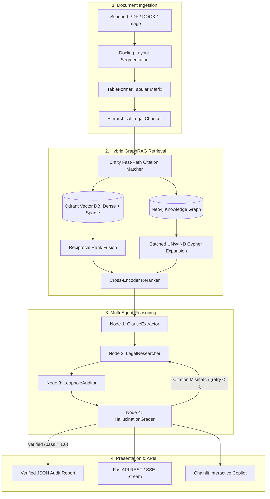

# LexiGuard Technical Documentation and System Architecture

This directory contains technical specifications, architecture blueprints, data models, and empirical benchmark documentation for the LexiGuard system.

---

## 1. Technical Specification Index

| Document | Subsystem / Focus Area | Key Technologies | Description |
| :--- | :--- | :--- | :--- |
| [01. Multimodal Document AI & OCR Pipeline](01_ocr_and_vision_pipeline.md) | Ingestion & Spatial Provenance | IBM Docling, DocLayNet, TableFormer, pypdfium2 | Layout analysis, table matrix extraction, and coordinate bounding boxes. |
| [02. Hierarchical Statutory Parsing & Knowledge Graph](02_data_schema_and_hierarchical_graph_ingestion.md) | Data Models & Graph Ingestion | Pydantic v2, Neo4j, Cypher UNWIND, AST Chunker | Civil law hierarchy segmentation (`Part` -> `Chapter` -> `Article` -> `Clause`). |
| [03. Hybrid GraphRAG Architecture](03_hybrid_graphrag_qdrant_neo4j.md) | Retrieval & Lifecycle Management | Qdrant, Neo4j, Reciprocal Rank Fusion, Cross-Encoder | 3-stage hybrid search, Entity Fast-Path citation routing, and multi-hop graph traversal. |
| [04. Multi-Agent Workflow & State Machine](04_fastmcp_multiagent_langgraph.md) | Multi-Agent Orchestration & Auditing | LangGraph, FastMCP Server, HallucinationGrader | 4-node cyclic workflow with deterministic table math and citation verification. |

---

## 2. End-to-End System Architecture

LexiGuard operates as a multi-stage pipeline designed for high precision in legal reasoning:



---

## 3. Core Design Principles

1. **Deterministic Grounding**: Every finding must trace back to explicit statutory articles and clauses present in the database. LLMs are not permitted to invent citations or extrapolate policy.
2. **Dual-Ended Provenance**: Findings link visual bounding box coordinates on the input contract PDF directly to verified database points and statutory authority nodes.
3. **Deterministic Graph Expansion**: Cross-statutory citations (`REFERENCES`, `EXCEPTION_TO`, `CITES_CLAUSE`, `SUPERSEDES`) are parsed via exact regex rules and mapped into Neo4j for 1-to-2 hop queries.
4. **Asynchronous Connection Lifecycle**: Persistent connection pooling across Qdrant and Neo4j maximizes throughput and avoids socket exhaustion.
5. **Constant Time O(1) Vector-Graph Alignment**: Qdrant points utilize `UUIDv5(chunk_id)`, enabling direct lookups between vector embeddings and graph entities without secondary index tables.

---

## 4. Empirical Evaluation Reports

The system is continuously benchmarked against standard statutory test suites and real-world legal datasets:

- **[VLegal-Bench Evaluation Report](../reports/VLEGAL_BENCHMARK_REPORT.md)**:
  - **Task 3.4 (Conflict & Consistency Detection)**: 95.18% Accuracy, 97.56% Conflict Precision, 96.00% Conflict Recall, 0.9677 F1 Score across 166 pairs.
  - **Task 2.3 (Legal Graph Structuring)**: 89 exact triplets extracted, 0.1958 Graph F1 across 326 samples.
- **[ALQAC Master Evaluation Report](../reports/ALQAC_MASTER_BENCHMARK_REPORT.md)**:
  - Automated Legal Question Answering benchmark validating hybrid retrieval performance across civil and commercial legal codes.
- **[Deterministic Benchmark Summary](../data/eval_dataset/benchmark_results_summary.md)**:
  - Evaluates table arithmetic calculations, payload indexing, and citation verification guardrails.

---

## 5. Architectural Directory Map

```plaintext
docs/
|-- README.md                                           # System architecture and documentation index
|-- 01_ocr_and_vision_pipeline.md                       # Multimodal layout analysis and table extraction
|-- 02_data_schema_and_hierarchical_graph_ingestion.md  # Legislative AST and Neo4j batch schemas
|-- 03_hybrid_graphrag_qdrant_neo4j.md                  # 3-stage hybrid search and lifecycle sync
|-- 04_fastmcp_multiagent_langgraph.md                  # Multi-agent state machine and MCP tools
`-- assets/                                             # Technical diagrams and topology images
    |-- single_branch_ocr_pipeline.png
    |-- hierarchical_schema_and_graph.png
    |-- neoj4_viz.png
    |-- hybrid_graphrag_retrieval.png
    `-- multiagent_langgraph_workflow.png
```
