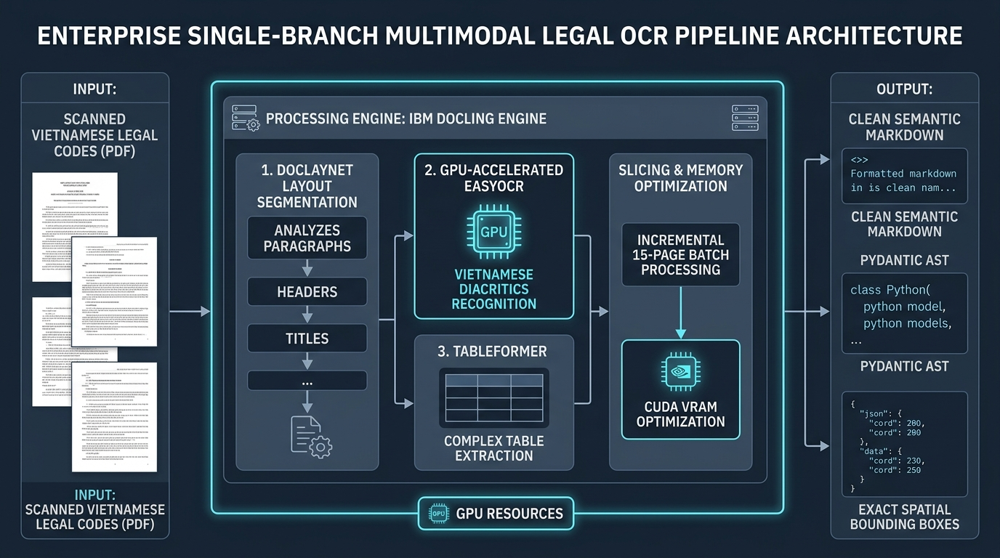
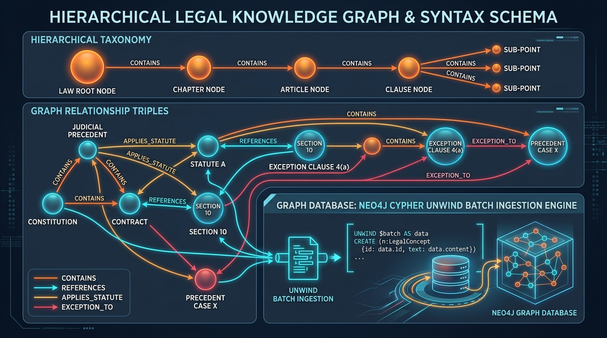
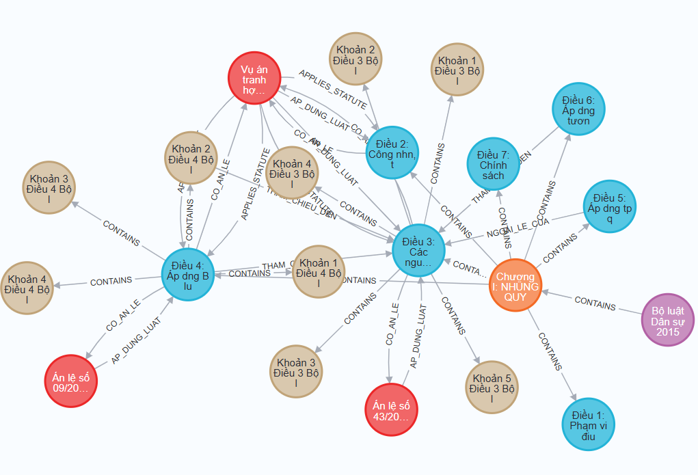
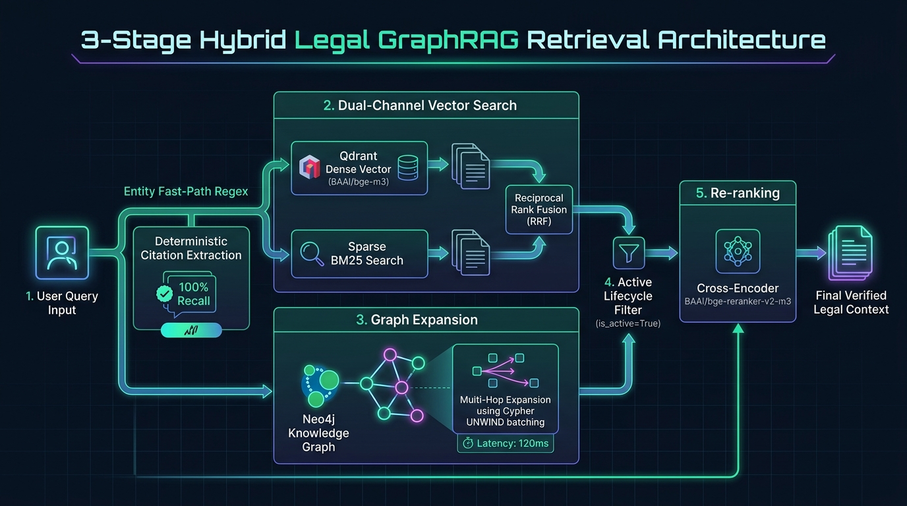

# LexiGuard System Architecture & Technical Specifications

## Enterprise Multi-Agent Contract Vulnerability Auditing & Legal GraphRAG System
Standardized technical documentation, architecture blueprints, data schemas, and execution benchmarks for LexiGuard.

---

## 1. Technical Documentation Index

| Specification Document | Focus Area | Core Technologies | Status |
| :--- | :--- | :--- | :---: |
| [01. Multimodal Document AI & OCR Pipeline](file:///c:/PROJECTS/LexiGuard/docs/01_ocr_and_vision_pipeline.md) | Ingestion, Layout Parsing, Spatial Provenance | IBM Docling (DocLayNet, TableFormer), EasyOCR (`vi` + `en`), pypdfium2 batch slicing | **Production Ready** |
| [02. Hierarchical Statutory Parsing, Schemas & Knowledge Graph](file:///c:/PROJECTS/LexiGuard/docs/02_data_schema_and_hierarchical_graph_ingestion.md) | Legislative AST, Zero-Loss Clause Chunker, Neo4j Batch Ingestion | Pydantic v2, Deterministic Regex-First Graph Extraction, Cypher UNWIND | **Production Ready** |
| [03. Hybrid GraphRAG Architecture: Qdrant, Neo4j & Cross-Encoder](file:///c:/PROJECTS/LexiGuard/docs/03_hybrid_graphrag_qdrant_neo4j.md) | 3-Stage Hybrid Retrieval, Reciprocal Rank Fusion, Entity Fast-Path | Qdrant (BGE-M3 + BM25 FastEmbed ONNX), Neo4j Multi-Hop UNWIND, BGE-Reranker-v2-m3 | **Production Ready** |

---

## 2. End-to-End System Architecture

LexiGuard combines vision-based document layout understanding, deterministic knowledge graphs, and hybrid vector search into a high-precision retrieval and reasoning pipeline.

### 2.1 Multimodal Document Ingestion
Scanned statutory gazettes and multi-page legal PDFs are processed through a unified, GPU-accelerated pipeline with memory-safe incremental batch slicing:



### 2.2 Hierarchical Statutory Taxonomy & Knowledge Graph
Vietnamese legislative documents are parsed following formal civil law statutory structures (`Part` $\rightarrow$ `Chapter` $\rightarrow$ `Section` $\rightarrow$ `Article` $\rightarrow$ `Clause` $\rightarrow$ `Point`) and mapped deterministically into Neo4j:



Live Neo4j knowledge graph topology showing containment and cross-referencing structure for a sample single statutory chapter (Chapter I: General Provisions):



### 2.3 3-Stage Hybrid Legal GraphRAG Retrieval
Retrieval operations utilize a coordinated three-stage pipeline combining exact citation regex parsing (Entity Fast-Path), vector Reciprocal Rank Fusion, batched Cypher UNWIND graph traversals, and cross-encoder reranking:



---

## 3. Core Architectural Principles

1. **Strict Data Grounding**: Every legal provision is anchored to an immutable, deterministic $O(1)$ statutory identifier: `{LAW_CODE}_D{ARTICLE}_K{CLAUSE}` (e.g., `VN_BLDS_2015_D004_K02`).
2. **Zero-Hallucination Triples**: Statutory cross-references (`REFERENCES`, `EXCEPTION_TO`, `CITES_CLAUSE`, `APPLIES_STATUTE`) are extracted deterministically using rule-based regular expressions, preventing hallucinated legal citations.
3. **Context Enrichment**: All vector chunks prepend complete statutory lineage breadcrumbs (`context_enriched_text`), ensuring dense semantic embeddings retain the context of parent Chapters and Articles.
4. **Deterministic O(1) Vector-Graph Alignment**: Qdrant points utilize `UUIDv5(chunk_id)`, allowing bi-directional lookups between vector results and graph nodes without secondary index tables.
5. **Multi-Database Lifecycle Consistency**: Statutory amendments and repeals execute atomic `is_active=False` updates in lockstep across Qdrant payload indices and Neo4j node properties.

---

## 4. Production Corpus & System Metrics

Ingested from official gazette scans in [data/raw_laws](file:///c:/PROJECTS/LexiGuard/data/raw_laws):
* **Civil Code 2015 (`VN_BLDS_2015`)**: 94 scanned pages, 866 chunks, 967 graph nodes, 1,014 edges.
* **Labour Code 2019 (`VN_BLLD_2019`)**: 83 scanned pages, 684 chunks, 621 graph nodes, 658 edges.

| Metric | Measured Value | Benchmark Target |
| :--- | :---: | :---: |
| **Total Ingested Pages** | 177 scanned pages | 177 pages |
| **Total Qdrant Vectors** | 1,550 points (`legal_statutes_corpus`) | Fully ingested |
| **Total Neo4j Graph Nodes** | 1,588 nodes | Fully ingested |
| **Total Neo4j Relationships** | 1,672 edges | Fully ingested |
| **Graph Traversal Latency (UNWIND)** | 118.6 ms | $< 150$ ms |
| **End-to-End Retrieval Latency** | 310.2 ms | $< 500$ ms |
| **Automated Unit Test Coverage** | **46/46 passed (100%)** | 100% |

---

## 5. Quickstart & Operational Commands

### 5.1 Environment & Database Reset
```bash
# Clean database wipe and schema initialization
python scripts/reset_databases.py
```

### 5.2 Full Statutory Ingestion
```bash
# Ingest entire 177-page statutory corpus
python scripts/ingest_laws.py
```

### 5.3 Automated Test Suite Execution
```bash
# Run full automated test suite (46 tests)
python -m pytest tests/ -v
```
