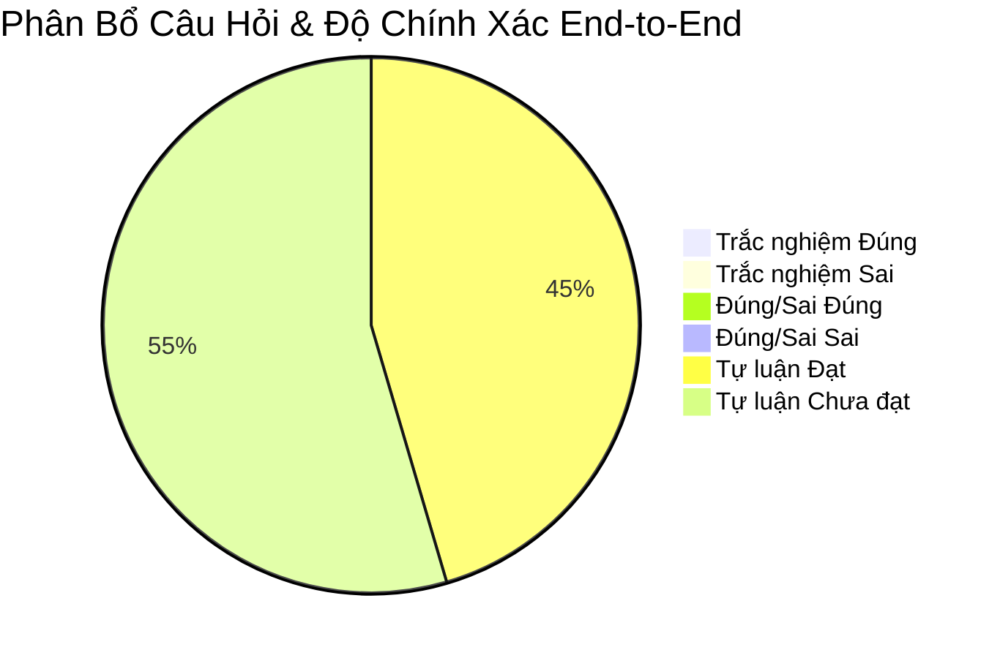
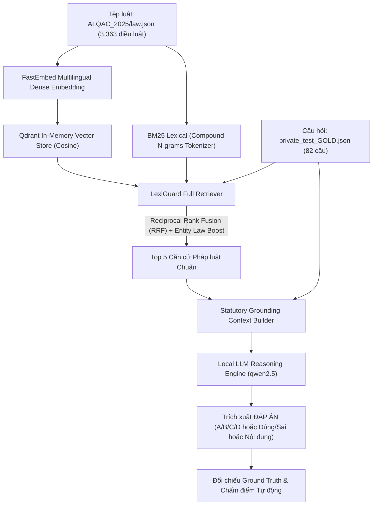

# Báo Cáo Đánh Giá Hệ Thống End-to-End: ALQAC 2025

**Hệ thống:** LexiGuard Autonomous Multi-Agent Legal Platform  
**Corpus văn bản pháp luật:** `data/alqac/ALQAC_2025/law.json` (3,363 điều luật, 28 đạo luật)  
**Tập câu hỏi kiểm thử:** `data/alqac/ALQAC_2025/private_test_GOLD.json` (11 câu hỏi)  
**Mô hình suy luận LLM:** `qwen2.5:3b` (Local Ollama)  
**Thời gian hoàn thành:** 2026-10-30 15:12:55  

---

## 1. Tóm Tắt Chỉ Số Hiệu Năng Tổng Thể (Executive KPI Summary)

| Phân hệ / Chỉ số đánh giá | Giá trị đạt được | Tỷ lệ thành công | Ý nghĩa hệ thống |
| :--- | :---: | :---: | :--- |
| **Hybrid Hit Rate@1** | **54.55%** | `6/11` | Tỷ lệ điều luật đứng đầu bảng xếp hạng là căn cứ chuẩn |
| **Hybrid Hit Rate@3** | **72.73%** | `8/11` | Xác suất điều luật vàng xuất hiện trong Top 3 trích dẫn |
| **Hybrid Hit Rate@5** | **81.82%** | `9/11` | Khả năng bao phủ căn cứ pháp luật cung cấp cho LLM |
| **Hybrid MRR@5** | **0.6439** | - | Điểm xếp hạng nghịch đảo trung bình trong Top 5 |
| **Hybrid Multi-Item Recall@5**| **81.82%** | - | Độ phủ điều luật trong các câu hỏi đa căn cứ |
| **Độ chính xác End-to-End (Overall)** | **45.45%** | `5/11` | **Tỷ lệ LLM trả lời đúng tuyệt đối toàn bộ quy trình** |

---

## 2. Chi Tiết Hiệu Suất Theo Từng Dạng Câu Hỏi

| Dạng câu hỏi | Số lượng câu | Hit Rate@5 | Độ chính xác LLM | Latency TB / câu (LLM) |
| :--- | :---: | :---: | :---: | :---: |
| **Tự luận** | 11 | **81.82%** | **45.45%** (5/11) | 5.21s |

---

## 3. Kiến Trúc Đường Ống Đánh Giá End-to-End

---

## 4. Mẫu Chi Tiết Các Trường Hợp Kiểm Thử Tiêu Biểu

### Câu hỏi: `private_test_alquac25_16` (Tự luận) - ✅ **CHÍNH XÁC**
- **Nội dung:** Kinh phí cho hoạt động phòng, chống tác hại của rượu, bia có thể sử dụng từ những nguồn kinh phí nào?
- **Căn cứ vàng (Gold Relevant):** `[('Luật Phòng, chống tác hại của rượu, bia', '26')]` (Hit@5: ✅ Đạt)
- **Top 3 điều luật tra cứu:**
  1. [Luật Phòng, chống tác hại của rượu, bia - Điều 26] Kinh phí cho hoạt động phòng, chống tác hại của rượu, bia (Điểm: `0.03279`)
  1. [Luật Phòng, chống tác hại của rượu, bia - Điều 1] Phạm vi điều chỉnh (Điểm: `0.032`)
  1. [Luật Phòng, chống tác hại của rượu, bia - Điều 3] Chính sách của Nhà nước trong phòng, chống tác hại của rượu, bia (Điểm: `0.03041`)
- **Đáp án chuẩn (Gold):** `Ngân sách nhà nước và kinh phí hợp pháp khác.`
- **Dự đoán của LLM:** `Ngân sách nhà nước và kinh phí hợp pháp khác.`
- **Thời gian xử lý:** Tra cứu `62.91ms` | LLM `9.29s`
- **Trích đoạn giải trình của LLM:**
> <thinking> 1. Câu hỏi yêu cầu xác định nguồn kinh phí cho hoạt động phòng, chống tác hại của rượu, bia. 2. Căn cứ pháp luật quy định rõ nguồn kinh phí cho hoạt động phòng, chống tác hại của rượu, bia bao gồm: Ngân sách nhà nước và kinh phí hợp pháp khác. </thinking>  ĐÁP ÁN: Ngân sách nhà nước và kinh phí hợp pháp khác.  GIẢI THÍCH: Luật Phòng, chống tác hại của rượu, bia - Điều 26.

---
### Câu hỏi: `private_test_alquac25_36` (Tự luận) - ✅ **CHÍNH XÁC**
- **Nội dung:** Thông tin liên quan đến việc hòa giải giữa tổ chức, cá nhân kinh doanh và người tiêu dùng không phải bảo đảm nguyên tắc bí mật trong trường hợp nào?
- **Căn cứ vàng (Gold Relevant):** `[('Luật Bảo vệ quyền lợi người tiêu dùng', '62')]` (Hit@5: ✅ Đạt)
- **Top 3 điều luật tra cứu:**
  1. [Luật Bảo vệ quyền lợi người tiêu dùng - Điều 62] Nguyên tắc thực hiện hòa giải (Điểm: `0.03132`)
  1. [Luật Bảo vệ quyền lợi người tiêu dùng - Điều 19] Bảo đảm an toàn, an ninh thông tin của người tiêu dùng (Điểm: `0.02964`)
  1. [Luật Bảo vệ quyền lợi người tiêu dùng - Điều 80] Điều khoản chuyển tiếp (Điểm: `0.02951`)
- **Đáp án chuẩn (Gold):** `Trường hợp các bên có thỏa thuận khác hoặc pháp luật có quy định khác.`
- **Dự đoán của LLM:** `trường hợp các bên có thỏa thuận khác hoặc pháp luật có quy định khác`
- **Thời gian xử lý:** Tra cứu `58.9ms` | LLM `4.62s`
- **Trích đoạn giải trình của LLM:**
> <thinking> 1. Câu hỏi yêu cầu xác định trường hợp nào không phải bảo đảm nguyên tắc bí mật trong việc hòa giải giữa tổ chức, cá nhân kinh doanh và người tiêu dùng. 2. Căn cứ pháp luật quan trọng liên quan là Điều 62 của Luật Bảo vệ quyền lợi người tiêu dùng, quy định rằng thông tin liên quan đến việc hòa giải phải bảo đảm bí mật ngoại trừ trường hợp các bên có thỏa thuận khác hoặc pháp luật có quy định khác. </thinking>  ĐÁP ÁN: <trường hợp các bên có thỏa thuận khác hoặc pháp luật có quy định khác>  GIẢI THÍCH: <Luật Bảo vệ quyền lợi người tiêu dùng - Điều 62>

---
### Câu hỏi: `private_test_alquac25_39` (Tự luận) - ✅ **CHÍNH XÁC**
- **Nội dung:** Chính phủ yêu cầu báo cáo kết quả theo dõi, đánh giá việc quản lý và sử dụng đất đai tại các tỉnh có các dự án quy mô lớn sử dụng đất với diện tích lớn. Theo quy định của Luật Đất đai, cơ quan nào có trách nhiệm thực hiện nhiệm vụ này?
- **Căn cứ vàng (Gold Relevant):** `[('Luật Đất đai', '232')]` (Hit@5: ✅ Đạt)
- **Top 3 điều luật tra cứu:**
  1. [Luật Đất đai - Điều 233] Hệ thống theo dõi và đánh giá đối với việc quản lý, sử dụng đất đai (Điểm: `0.03175`)
  1. [Luật Đất đai - Điều 55] Trách nhiệm tổ chức thực hiện điều tra, đánh giá đất đai, bảo vệ, cải tạo, phục hồi đất (Điểm: `0.03132`)
  1. [Luật Đất đai - Điều 76] Tổ chức thực hiện quy hoạch, kế hoạch sử dụng đất (Điểm: `0.03102`)
- **Đáp án chuẩn (Gold):** `Bộ Tài nguyên và Môi trường`
- **Dự đoán của LLM:** `Bộ Tài nguyên và Môi trường`
- **Thời gian xử lý:** Tra cứu `87.43ms` | LLM `4.8s`
- **Trích đoạn giải trình của LLM:**
> <thinking> 1. Câu hỏi yêu cầu xác định cơ quan có trách nhiệm thực hiện nhiệm vụ theo dõi và đánh giá việc quản lý, sử dụng đất đai. 2. Căn cứ pháp luật quan trọng liên quan là Điều 233 của Luật Đất đai, cụm từ cốt lõi là "chủ trì, phối hợp với các Bộ có liên quan thực hiện các nhiệm vụ sau đây". </thinking>  ĐÁP ÁN: Bộ Tài nguyên và Môi trường GIẢI THÍCH: Luật Đất đai - Điều 233.

---
### Câu hỏi: `private_test_alquac25_53` (Tự luận) - ❌ **CHƯA ĐÚNG**
- **Nội dung:** Tòa án triệu tập hợp lệ lần thứ hai, người khởi kiện và người đại diện theo pháp luật của người khởi kiện vắng mặt không vì sự kiện bất khả kháng, trở ngại khách quan thì Tòa án xử lý như thể nào?
- **Căn cứ vàng (Gold Relevant):** `[('Luật Tố tụng hành chính', '157')]` (Hit@5: ❌ Trượt)
- **Top 3 điều luật tra cứu:**
  1. [Luật Tố tụng hành chính - Điều 143] Đình chỉ giải quyết vụ án (Điểm: `0.03175`)
  1. [Luật Tố tụng hành chính - Điều 168] Thủ tục xét xử vắng mặt tất cả những người tham gia tố tụng (Điểm: `0.03125`)
  1. [Luật Tố tụng hành chính - Điều 135] Những vụ án hành chính không tiến hành đối thoại được (Điểm: `0.03054`)
- **Đáp án chuẩn (Gold):** `Tòa án ra quyết định đình chỉ giải quyết vụ án đối với yêu cầu khởi kiện của người khởi kiện đó`
- **Dự đoán của LLM:** `15 ngày`
- **Thời gian xử lý:** Tra cứu `75.91ms` | LLM `5.47s`
- **Trích đoạn giải trình của LLM:**
> <thinking> 1. Câu hỏi yêu cầu xác định điều gì: Tòa án xử lý như thế nào khi người khởi kiện và người đại diện theo pháp luật của người khởi kiện vắng mặt không vì sự kiện bất khả kháng, trở ngại khách quan sau khi đã được triệu tập hợp lệ lần thứ hai. 2. Tìm câu từ quy định trực tiếp trong căn cứ pháp luật để trích xuất cụm từ cốt lõi ngắn gọn nhất. </thinking>  ĐÁP ÁN: 15 ngày GIẢI THÍCH: Luật Tố tụng hành chính - Điều 168: Thủ tục xét xử vắng mặt tất cả những người tham gia tố tụng. Trường hợp người khởi kiện, người đại diện hợp pháp của người khởi kiện đã được triệu tập hợp lệ lần thứ hai mà vẫn vắng mặt, Tòa án căn cứ vào tài liệu, chứng cứ có trong hồ sơ để xét xử vắng mặt đương sự.

---
### Câu hỏi: `private_test_alquac25_61` (Tự luận) - ❌ **CHƯA ĐÚNG**
- **Nội dung:** Theo Luật Giá, hàng hóa là gì?
- **Căn cứ vàng (Gold Relevant):** `[('Luật Giá', '4')]` (Hit@5: ✅ Đạt)
- **Top 3 điều luật tra cứu:**
  1. [Luật Giá - Điều 4] Giải thích từ ngữ (Điểm: `0.05151`)
  1. [Luật Giá - Điều 30] Giá tham chiếu (Điểm: `0.05126`)
  1. [Luật Giá - Điều 9] Nghĩa vụ của tổ chức, cá nhân kinh doanh hàng hóa, dịch vụ (Điểm: `0.0511`)
- **Đáp án chuẩn (Gold):** `Sản phẩm có thể trao đổi, mua, bán trên thị trường`
- **Dự đoán của LLM:** `hàng hóa`
- **Thời gian xử lý:** Tra cứu `32.78ms` | LLM `4.21s`
- **Trích đoạn giải trình của LLM:**
> <thinking> 1. Câu hỏi yêu cầu xác định điều gì: tên cơ quan, con số/thời hạn, số tiền, định nghĩa hay điều kiện pháp lý? 2. Tìm câu từ quy định trực tiếp trong căn cứ pháp luật để trích xuất cụm từ cốt lõi nhất về định nghĩa của "hàng hóa". </thinking>  ĐÁP ÁN: hàng hóa GIẢI THÍCH: <Luật Giá - Điều 4>

---
