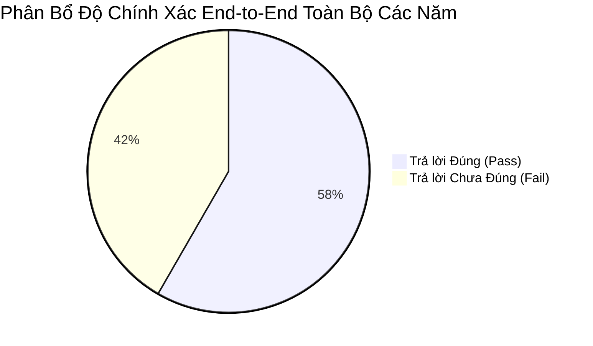
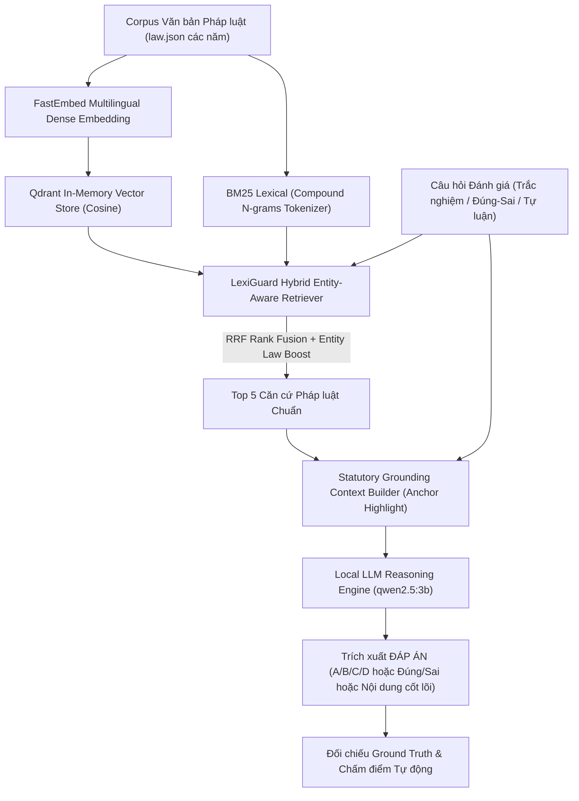

# Báo Cáo Đánh Giá Hệ Thống End-to-End Toàn Diện: ALQAC (2022 - 2025)

**Hệ thống:** LexiGuard Autonomous Multi-Agent Legal Platform  
**Các mùa giải đánh giá:** `ALQAC 2022`, `ALQAC 2023`, `ALQAC 2024`, `ALQAC 2025`  
**Mô hình suy luận LLM:** `qwen2.5:3b` (Local Ollama, Zero-Temperature, Deliberative Reasoning)  
**Thời gian hoàn thành:** 2026-10-30 19:29:10  

---

## 1. Tóm Tắt Chỉ Số Hiệu Năng End-to-End Qua Các Mùa Giải (Executive KPI Summary)

| Mùa giải | Số câu kiểm thử | Hit Rate@1 | Hit Rate@3 | Hit Rate@5 | MRR@5 | Multi-Item Recall@5 | **Độ chính xác E2E (LLM)** |
| :--- | :---: | :---: | :---: | :---: | :---: | :---: | :---: |
| **ALQAC 2022** | 12 | 75.0% | 91.7% | 91.7% | 0.8333 | 91.7% | **41.7%** (5/12) |
| **ALQAC 2023** | 12 | 50.0% | 75.0% | 83.3% | 0.6458 | 83.3% | **58.3%** (7/12) |
| **ALQAC 2024** | 12 | 83.3% | 83.3% | 91.7% | 0.8500 | 91.7% | **58.3%** (7/12) |
| **ALQAC 2025** | 12 | 58.3% | 75.0% | 83.3% | 0.6833 | 83.3% | **75.0%** (9/12) |
| **TOÀN BỘ CORPUS (Trung bình)** | **48** | **66.7%** | **81.2%** | **87.5%** | **0.7531** | **87.5%** | **58.3%** (28/48) |

---

## 2. Chi Tiết Hiệu Suất Theo Từng Dạng Câu Hỏi (Question Type Breakdown)

| Dạng câu hỏi | Tổng số câu | Hit Rate@5 | Độ chính xác LLM | Latency TB / câu (LLM) |
| :--- | :---: | :---: | :---: | :---: |
| **Trắc nghiệm** | 14 | **92.9%** | **71.4%** (10/14) | 6.59s |
| **Tự luận** | 22 | **86.4%** | **54.5%** (12/22) | 3.76s |
| **Đúng/Sai** | 12 | **83.3%** | **50.0%** (6/12) | 6.48s |

---

## 3. Kiến Trúc Đường Ống Đánh Giá End-to-End

---

## 4. Mẫu Chi Tiết Các Trường Hợp Kiểm Thử Tiêu Biểu (Đúng & Sai của AI Trả Lời)

### 🏛️ MÙA GIẢI ALQAC 2022

#### 🟢 CÁC TRƯỜNG HỢP AI TRẢ LỜI ĐÚNG TIÊU BIỂU (ALQAC 2022)

##### Ví dụ đúng #1: `q-1` (Tự luận) - ✅ **CHÍNH XÁC**
- **Nội dung câu hỏi:** Chiếm đoạt di vật của tử sĩ có thể bị phạt tù lên đến bao nhiêu năm?
- **Căn cứ vàng (Gold Relevant):** `[('01/VBHN-VPQH', '418')]` (Hit@5: ✅ Đạt)
- **Top 3 điều luật tra cứu:**
  1. [01/VBHN-VPQH - Điều 418] Tội chiếm đoạt hoặc hủy hoại di vật của tử sỹ (Điểm: `0.05082`)
  1. [01/VBHN-VPQH - Điều 319] Tội xâm phạm thi thể, mồ mả, hài cốt (Điểm: `0.04816`)
  1. [01/VBHN-VPQH - Điều 154] Tội mua bán, chiếm đoạt mô hoặc bộ phận cơ thể người (Điểm: `0.0424`)
- **Đáp án chuẩn (Gold):** `07 năm`
- **Dự đoán của LLM:** `07 năm`
- **Thời gian xử lý:** Tra cứu `590.23ms` | LLM `7.96s`
- **Trích đoạn suy luận Deliberative Reasoning của LLM:**
> ĐÁP ÁN: 07 năm GIẢI THÍCH: Điều 418, Khoản 2, điểm b) của Bộ luật Hình sự 2015 quy định mức phạt từ 02 năm đến 07 năm tù cho hành vi chiếm đoạt hoặc hủy hoại di vật của tử sĩ trong trường hợp phạm tội thuộc một trong các trường hợp sau đây, trong đó bao gồm việc chiếm đoạt hoặc hủy hoại di vật của 02 tử sĩ trở lên....

##### Ví dụ đúng #2: `q-44` (Tự luận) - ✅ **CHÍNH XÁC**
- **Nội dung câu hỏi:** Tội phạm là hành vi nguy hiểm cho xã hội được quy định trong Bộ luật nào?
- **Căn cứ vàng (Gold Relevant):** `[('01/VBHN-VPQH', '8')]` (Hit@5: ✅ Đạt)
- **Top 3 điều luật tra cứu:**
  1. [01/VBHN-VPQH - Điều 8] Khái niệm tội phạm (Điểm: `0.05056`)
  1. [01/VBHN-VPQH - Điều 9] Phân loại tội phạm (Điểm: `0.05026`)
  1. [01/VBHN-VPQH - Điều 57] Quyết định hình phạt trong trường hợp chuẩn bị phạm tội, phạm tội chưa đạt (Điểm: `0.04921`)
- **Đáp án chuẩn (Gold):** `Bộ luật Hình sự`
- **Dự đoán của LLM:** `Bộ luật hình sự`
- **Thời gian xử lý:** Tra cứu `652.88ms` | LLM `3.29s`
- **Trích đoạn suy luận Deliberative Reasoning của LLM:**
> Đáp án: <Bộ luật hình sự> GIẢI THÍCH: <01/VBHN-VPQH - Điều 8>...

#### 🔴 CÁC TRƯỜNG HỢP AI TRẢ LỜI CHƯA ĐÚNG (ALQAC 2022)

##### Ví dụ sai #1: `q-87` (Tự luận) - ❌ **CHƯA ĐÚNG**
- **Nội dung câu hỏi:** Bên mua cần thanh toán tiền lúc nào trong trường hợp các bên không có thoả thuận về thời gian giao tài sản và thời hạn thanh toán?
- **Căn cứ vàng (Gold Relevant):** `[('91/2015/QH13', '440')]` (Hit@5: ✅ Đạt)
- **Top 3 điều luật tra cứu:**
  1. [91/2015/QH13 - Điều 440] Nghĩa vụ trả tiền (Điểm: `0.05082`)
  1. [91/2015/QH13 - Điều 434] Thời hạn thực hiện hợp đồng mua bán (Điểm: `0.04977`)
  1. [91/2015/QH13 - Điều 561] Trả tiền công (Điểm: `0.04847`)
- **Đáp án chuẩn (Gold):** `tại thời điểm nhận tài sản`
- **Dự đoán của LLM:** `15 ngày`
- **Thời gian xử lý:** Tra cứu `644.69ms` | LLM `3.4s`
- **Trích đoạn suy luận Deliberative Reasoning của LLM:**
> Đáp án: <15 ngày>  Giải thích: <91/2015/QH13 - Điều 440>...

##### Ví dụ sai #2: `q-130` (Tự luận) - ❌ **CHƯA ĐÚNG**
- **Nội dung câu hỏi:** Mức khấu trừ tối đa là bao nhiêu?
- **Căn cứ vàng (Gold Relevant):** `[('45/2019/QH14', '102')]` (Hit@5: ✅ Đạt)
- **Top 3 điều luật tra cứu:**
  1. [91/2015/QH13 - Điều 533] Cước phí vận chuyển (Điểm: `0.03379`)
  1. [45/2019/QH14 - Điều 102] Khấu trừ tiền lương (Điểm: `0.02957`)
  1. [91/2015/QH13 - Điều 561] Trả tiền công (Điểm: `0.02845`)
- **Đáp án chuẩn (Gold):** `không được quá 30% tiền lương thực trả hằng tháng của người lao động`
- **Dự đoán của LLM:** `18 tuổi`
- **Thời gian xử lý:** Tra cứu `469.88ms` | LLM `3.4s`
- **Trích đoạn suy luận Deliberative Reasoning của LLM:**
> Đáp án: <18 tuổi> GIẢI THÍCH: <91/2015/QH13 - Điều 561 - Khoản 3>...

---

### 🏛️ MÙA GIẢI ALQAC 2023

#### 🟢 CÁC TRƯỜNG HỢP AI TRẢ LỜI ĐÚNG TIÊU BIỂU (ALQAC 2023)

##### Ví dụ đúng #1: `TN-13` (Trắc nghiệm) - ✅ **CHÍNH XÁC**
- **Nội dung câu hỏi:** Hồ sơ đề nghị cấp thẻ hướng dẫn viên du lịch quốc tế không bao gồm thứ gì sau đây?
- **Căn cứ vàng (Gold Relevant):** `[('Luật Du lịch', '60')]` (Hit@5: ✅ Đạt)
- **Top 3 điều luật tra cứu:**
  1. [Luật Du lịch - Điều 60] Hồ sơ, trình tự, thủ tục, thẩm quyền cấp thẻ hướng dẫn viên du lịch quốc tế, thẻ hướng dẫn viên du lịch nội địa (Điểm: `0.05082`)
  1. [Luật Du lịch - Điều 62] Cấp đổi thẻ hướng dẫn viên du lịch (Điểm: `0.04977`)
  1. [Luật Du lịch - Điều 61] Hồ sơ, trình tự, thủ tục, thẩm quyền cấp thẻ hướng dẫn viên du lịch tại điểm (Điểm: `0.04872`)
- **Đáp án chuẩn (Gold):** `C`
- **Dự đoán của LLM:** `C`
- **Thời gian xử lý:** Tra cứu `521.74ms` | LLM `5.89s`
- **Trích đoạn suy luận Deliberative Reasoning của LLM:**
> ĐÁP ÁN: C GIẢI THÍCH: Theo Điều 60 của Luật Du lịch, Hồ sơ đề nghị cấp thẻ hướng dẫn viên du lịch quốc tế bao gồm: đơn đề nghị cấp thẻ hướng dẫn viên du lịch theo mẫu do Bộ trưởng Bộ Văn hóa, Thể thao và Du lịch quy định; sơ yếu lý lịch có xác nhận của Ủy ban nhân dân cấp xã nơi cư trú; bản sao có chứng thực các văn bằng, chứng chỉ tương ứng với đi...

##### Ví dụ đúng #2: `TN-19` (Trắc nghiệm) - ✅ **CHÍNH XÁC**
- **Nội dung câu hỏi:** Cơ quan nào có thẩm quyền cấp Giấy phép phân loại phim?
- **Căn cứ vàng (Gold Relevant):** `[('Luật Điện ảnh', '27')]` (Hit@5: ✅ Đạt)
- **Top 3 điều luật tra cứu:**
  1. [Luật Điện ảnh - Điều 29] Thu hồi Giấy phép phân loại phim (Điểm: `0.05082`)
  1. [Luật Điện ảnh - Điều 27] Cấp Giấy phép phân loại phim (Điểm: `0.05`)
  1. [Luật Điện ảnh - Điều 28] Thay đổi nội dung phim và tên phim trong Giấy phép phân loại phim (Điểm: `0.04898`)
- **Đáp án chuẩn (Gold):** `D`
- **Dự đoán của LLM:** `D`
- **Thời gian xử lý:** Tra cứu `508.8ms` | LLM `7.64s`
- **Trích đoạn suy luận Deliberative Reasoning của LLM:**
> <thinking> 1. Theo Điều 27 của Luật Điện ảnh, thẩm quyền cấp Giấy phép phân loại phim được quy định cho Bộ Văn hóa, Thể thao và Du lịch và Ủy ban nhân dân cấp tỉnh khi đáp ứng các điều kiện theo quy định của Bộ trưởng Bộ Văn hóa, Thể thao và Du lịch. 2. Phương án D tổng hợp cả hai thẩm quyền trên, cho phép Bộ Văn hóa, Thể thao và Du lịch và Ủy ban ...

#### 🔴 CÁC TRƯỜNG HỢP AI TRẢ LỜI CHƯA ĐÚNG (ALQAC 2023)

##### Ví dụ sai #1: `TN-1` (Trắc nghiệm) - ❌ **CHƯA ĐÚNG**
- **Nội dung câu hỏi:** Các khu vực nào sau đây cần phải có trong cơ sở cai nghiện ma túy công lập?
- **Căn cứ vàng (Gold Relevant):** `[('Luật Phòng, chống ma túy', '35')]` (Hit@5: ✅ Đạt)
- **Top 3 điều luật tra cứu:**
  1. [Luật Phòng, chống ma túy - Điều 35] Cơ sở cai nghiện ma túy công lập (Điểm: `0.05082`)
  1. [Luật Phòng, chống ma túy - Điều 36] Cơ sở cai nghiện ma túy tự nguyện (Điểm: `0.04838`)
  1. [Luật Phòng, chống ma túy - Điều 27] Xác định tình trạng nghiện ma túy (Điểm: `0.04444`)
- **Đáp án chuẩn (Gold):** `D`
- **Dự đoán của LLM:** `A`
- **Thời gian xử lý:** Tra cứu `52.55ms` | LLM `7.01s`
- **Trích đoạn suy luận Deliberative Reasoning của LLM:**
> <thinking> 1. Theo Căn cứ pháp luật, cơ sở cai nghiện ma túy công lập cần phải có các khu sau đây: khu lưu trú tạm thời, khu cai nghiện ma túy bắt buộc, và khu cai nghiện ma túy tự nguyện. 2. Phương án A (Khu lưu trú tạm thời) và phương án B (Khu cai nghiện ma túy bắt buộc) đều được quy định trong Căn cứ pháp luật. 3. Phương án C (Khu cai nghiện ma...

##### Ví dụ sai #2: `TN-7` (Trắc nghiệm) - ❌ **CHƯA ĐÚNG**
- **Nội dung câu hỏi:** Loại hợp đồng nào sau đây không được BLDS 2015 quy định?
- **Căn cứ vàng (Gold Relevant):** `[('Bộ luật dân sự', '402')]` (Hit@5: ❌ Trượt)
- **Top 3 điều luật tra cứu:**
  1. [Bộ luật dân sự - Điều 410] Thực hiện hợp đồng song vụ (Điểm: `0.04641`)
  1. [Bộ luật dân sự - Điều 403] Phụ lục hợp đồng (Điểm: `0.04387`)
  1. [Bộ luật dân sự - Điều 423] Huỷ bỏ hợp đồng (Điểm: `0.04213`)
- **Đáp án chuẩn (Gold):** `C`
- **Dự đoán của LLM:** `D`
- **Thời gian xử lý:** Tra cứu `433.46ms` | LLM `4.84s`
- **Trích đoạn suy luận Deliberative Reasoning của LLM:**
> ĐÁP ÁN: D GIẢI THÍCH:  Căn cứ vào các điều khoản trong Bộ luật Dân sự 2015, không có quy định nào liên quan đến "Hợp đồng có điều kiện". Các điều khoản được liệt kê trong các điều 403, 410, 417, 423 và 386 đều liên quan đến các loại hợp đồng khác nhau như hợp đồng song vụ, huỷ bỏ hợp đồng, không được sửa đổi hoặc huỷ bỏ hợp đồng vì lợi ích của ngườ...

---

### 🏛️ MÙA GIẢI ALQAC 2024

#### 🟢 CÁC TRƯỜNG HỢP AI TRẢ LỜI ĐÚNG TIÊU BIỂU (ALQAC 2024)

##### Ví dụ đúng #1: `04-TN-1` (Trắc nghiệm) - ✅ **CHÍNH XÁC**
- **Nội dung câu hỏi:** Hợp đồng làm việc có những nội dung chủ yếu nào sau đây:
- **Căn cứ vàng (Gold Relevant):** `[('Luật Viên chức', '26')]` (Hit@5: ✅ Đạt)
- **Top 3 điều luật tra cứu:**
  1. [Luật Viên chức - Điều 26] Nội dung và hình thức của hợp đồng làm việc (Điểm: `0.04742`)
  1. [Bộ luật dân sự - Điều 505] Nội dung của hợp đồng hợp tác (Điểm: `0.04535`)
  1. [Bộ luật dân sự - Điều 402] Các loại hợp đồng chủ yếu (Điểm: `0.04365`)
- **Đáp án chuẩn (Gold):** `D`
- **Dự đoán của LLM:** `D`
- **Thời gian xử lý:** Tra cứu `320.54ms` | LLM `4.47s`
- **Trích đoạn suy luận Deliberative Reasoning của LLM:**
> ĐÁP ÁN: D GIẢI THÍCH: Luật Viên chức - Điều 26: Nội dung và hình thức của hợp đồng làm việc (điều kiện 1) quy định rõ rằng hợp đồng làm việc có những nội dung chủ yếu sau: a) Tên, địa chỉ của đơn vị sự nghiệp công lập và người đứng đầu đơn vị sự nghiệp công lập; b) Họ tên, địa chỉ, ngày, tháng, năm sinh của người được tuyển dụng. Phương án D tổng h...

##### Ví dụ đúng #2: `04-TN-11` (Trắc nghiệm) - ✅ **CHÍNH XÁC**
- **Nội dung câu hỏi:** Nam nữ kết hôn với nhau phải tuân theo các điều kiện nào sau đây
- **Căn cứ vàng (Gold Relevant):** `[('Luật Hôn nhân và gia đình', '8')]` (Hit@5: ✅ Đạt)
- **Top 3 điều luật tra cứu:**
  1. [Luật Hôn nhân và gia đình - Điều 8] Điều kiện kết hôn (Điểm: `0.05082`)
  1. [Luật Hôn nhân và gia đình - Điều 14] Giải quyết hậu quả của việc nam, nữ chung sống với nhau như vợ chồng mà không đăng ký kết hôn (Điểm: `0.04898`)
  1. [Luật Hôn nhân và gia đình - Điều 16] Giải quyết quan hệ tài sản, nghĩa vụ và hợp đồng của nam, nữ chung sống với nhau như vợ chồng mà không đăng ký kết hôn (Điểm: `0.04809`)
- **Đáp án chuẩn (Gold):** `D`
- **Dự đoán của LLM:** `D`
- **Thời gian xử lý:** Tra cứu `572.33ms` | LLM `9.61s`
- **Trích đoạn suy luận Deliberative Reasoning của LLM:**
> <thinking> 1. Xác định chính xác quan hệ pháp luật và điều kiện mà câu hỏi đòi hỏi. Theo Điều 8 của Luật Hôn nhân và gia đình, nam và nữ phải tuân theo các điều kiện sau:     - Nam từ đủ 20 tuổi trở lên, nữ từ đủ 18 tuổi trở lên.    - Việc kết hôn do nam và nữ tự nguyện quyết định.    - Không bị mất năng lực hành vi dân sự.    - Việc kết hôn không ...

#### 🔴 CÁC TRƯỜNG HỢP AI TRẢ LỜI CHƯA ĐÚNG (ALQAC 2024)

##### Ví dụ sai #1: `04-TN-31` (Trắc nghiệm) - ❌ **CHƯA ĐÚNG**
- **Nội dung câu hỏi:** Trường hợp nào sau đây KHÔNG được coi là thực hiện quyền tiếp cận thông tin theo quy định của Luật Tiếp cận thông tin?
- **Căn cứ vàng (Gold Relevant):** `[('Luật Tiếp cận thông tin', '4')]` (Hit@5: ✅ Đạt)
- **Top 3 điều luật tra cứu:**
  1. [Luật Tiếp cận thông tin - Điều 4] Chủ thể thực hiện quyền tiếp cận thông tin (Điểm: `0.05058`)
  1. [Luật Tiếp cận thông tin - Điều 16] Áp dụng pháp luật về tiếp cận thông tin (Điểm: `0.04879`)
  1. [Luật Tiếp cận thông tin - Điều 3] Nguyên tắc bảo đảm quyền tiếp cận thông tin (Điểm: `0.04748`)
- **Đáp án chuẩn (Gold):** `C`
- **Dự đoán của LLM:** `A`
- **Thời gian xử lý:** Tra cứu `590.42ms` | LLM `9.96s`
- **Trích đoạn suy luận Deliberative Reasoning của LLM:**
> <thinking> 1. Xác định chính xác quan hệ pháp luật và điều kiện mà câu hỏi đòi hỏi. Theo Điều 4 của Luật Tiếp cận thông tin, công dân thực hiện quyền tiếp cận thông tin thông qua người đại diện theo pháp luật. Điều 16 quy định áp dụng các quy định về tiếp cận thông tin của các luật khác nếu không trái với quy định tại Điều 3 của Luật này. Điều 33 v...

##### Ví dụ sai #2: `04-TL-3` (Tự luận) - ❌ **CHƯA ĐÚNG**
- **Nội dung câu hỏi:** Ông A là viên chức quản lý thuộc đơn vị sự nghiệp công lập H. Theo quy định, đến ngày 30/5/2024 thì ông A đã đủ tuổi nghỉ hưu. Như vậy, cơ quan quản lý ông A phải thông báo cho ông A bằng văn bản thời điểm ông A nghỉ hưu trước ngày bao nhiêu?
- **Căn cứ vàng (Gold Relevant):** `[('Luật Viên chức', '2'), ('Luật Viên chức', '15')]` (Hit@5: ❌ Trượt)
- **Top 3 điều luật tra cứu:**
  1. [Luật Viên chức - Điều 46] Chế độ hưu trí (Điểm: `0.05082`)
  1. [Luật Viên chức - Điều 48] Quản lý viên chức (Điểm: `0.04782`)
  1. [Luật Viên chức - Điều 37] Bổ nhiệm viên chức quản lý (Điểm: `0.04731`)
- **Đáp án chuẩn (Gold):** `trước ngày 30/11/2023`
- **Dự đoán của LLM:** `03 tháng`
- **Thời gian xử lý:** Tra cứu `740.4ms` | LLM `3.44s`
- **Trích đoạn suy luận Deliberative Reasoning của LLM:**
> Đáp án: 03 tháng  Giải thích: <Luật Viên chức - Điều 46>...

---

### 🏛️ MÙA GIẢI ALQAC 2025

#### 🟢 CÁC TRƯỜNG HỢP AI TRẢ LỜI ĐÚNG TIÊU BIỂU (ALQAC 2025)

##### Ví dụ đúng #1: `private_test_alquac25_2` (Trắc nghiệm) - ✅ **CHÍNH XÁC**
- **Nội dung câu hỏi:** Khi nào áp dụng Luật Giao dịch điện tử 2023?
- **Căn cứ vàng (Gold Relevant):** `[('Luật Giao dịch điện tử', '52')]` (Hit@5: ✅ Đạt)
- **Top 3 điều luật tra cứu:**
  1. [Luật Giao dịch điện tử - Điều 53] Quy định chuyển tiếp (Điểm: `0.04977`)
  1. [Luật Giao dịch điện tử - Điều 4] Chính sách phát triển giao dịch điện tử (Điểm: `0.04967`)
  1. [Luật Giao dịch điện tử - Điều 2] Đối tượng áp dụng (Điểm: `0.04869`)
- **Đáp án chuẩn (Gold):** `D`
- **Dự đoán của LLM:** `D`
- **Thời gian xử lý:** Tra cứu `545.35ms` | LLM `3.69s`
- **Trích đoạn suy luận Deliberative Reasoning của LLM:**
> ĐÁP ÁN: D GIẢI THÍCH: <Luật Giao dịch điện tử - Điều 52: Hiệu lực thi hành, quy định "Luật này có hiệu lực thi hành từ ngày 01 tháng 7 năm 2024">...

##### Ví dụ đúng #2: `private_test_alquac25_24` (Trắc nghiệm) - ✅ **CHÍNH XÁC**
- **Nội dung câu hỏi:** “Chăn nuôi nông hộ” là hình thức chăn nuôi:
- **Căn cứ vàng (Gold Relevant):** `[('Luật Chăn nuôi', '2')]` (Hit@5: ✅ Đạt)
- **Top 3 điều luật tra cứu:**
  1. [Luật Chăn nuôi - Điều 2] Giải thích từ ngữ (Điểm: `0.04937`)
  1. [Luật Chăn nuôi - Điều 52] Quy mô chăn nuôi (Điểm: `0.04718`)
  1. [Luật Chăn nuôi - Điều 48] Quyền và nghĩa vụ của cơ sở sản xuất thức ăn chăn nuôi (Điểm: `0.04527`)
- **Đáp án chuẩn (Gold):** `C`
- **Dự đoán của LLM:** `C`
- **Thời gian xử lý:** Tra cứu `499.25ms` | LLM `3.64s`
- **Trích đoạn suy luận Deliberative Reasoning của LLM:**
> ĐÁP ÁN: C GIẢI THÍCH: Luật Chăn nuôi - Điều 2, khoản 3: "Chăn nuôi nông hộ là hình thức tổ chức hoạt động chăn nuôi tại hộ gia đình."...

#### 🔴 CÁC TRƯỜNG HỢP AI TRẢ LỜI CHƯA ĐÚNG (ALQAC 2025)

##### Ví dụ sai #1: `private_test_alquac25_61` (Tự luận) - ❌ **CHƯA ĐÚNG**
- **Nội dung câu hỏi:** Theo Luật Giá, hàng hóa là gì?
- **Căn cứ vàng (Gold Relevant):** `[('Luật Giá', '4')]` (Hit@5: ✅ Đạt)
- **Top 3 điều luật tra cứu:**
  1. [Luật Giá - Điều 4] Giải thích từ ngữ (Điểm: `0.06944`)
  1. [Luật Giá - Điều 21] Hàng hóa, dịch vụ do Nhà nước định giá (Điểm: `0.06735`)
  1. [Luật Giá - Điều 8] Quyền của tổ chức, cá nhân kinh doanh hàng hóa, dịch vụ (Điểm: `0.06527`)
- **Đáp án chuẩn (Gold):** `Sản phẩm có thể trao đổi, mua, bán trên thị trường`
- **Dự đoán của LLM:** `hàng hóa`
- **Thời gian xử lý:** Tra cứu `581.19ms` | LLM `3.73s`
- **Trích đoạn suy luận Deliberative Reasoning của LLM:**
> Đáp án: <hàng hóa>  GIẢI THÍCH: <Luật Giá - Điều 4, Khoản 1>...

##### Ví dụ sai #2: `private_test_alquac25_9` (Đúng/Sai) - ❌ **CHƯA ĐÚNG**
- **Nội dung câu hỏi:** Cảnh sát giao thông có thể xử phạt người điều khiển xe đạp nếu phát hiện có nồng độ cồn.
- **Căn cứ vàng (Gold Relevant):** `[('Luật Phòng, chống tác hại của rượu, bia', '5')]` (Hit@5: ❌ Trượt)
- **Top 3 điều luật tra cứu:**
  1. [Luật Phòng, chống tác hại của rượu, bia - Điều 21] Phòng ngừa tai nạn giao thông liên quan đến sử dụng rượu, bia (Điểm: `0.05035`)
  1. [Luật Đường bộ - Điều 63] Quyền và nghĩa vụ của người lái xe vận tải hàng hoá bằng xe ô tô (Điểm: `0.04716`)
  1. [Luật Phòng, chống tác hại của rượu, bia - Điều 35] Sửa đổi, bổ sung quy định của một số luật khác (Điểm: `0.04677`)
- **Đáp án chuẩn (Gold):** `Đúng`
- **Dự đoán của LLM:** `Sai`
- **Thời gian xử lý:** Tra cứu `679.45ms` | LLM `5.02s`
- **Trích đoạn suy luận Deliberative Reasoning của LLM:**
> ĐÁP ÁN: Sai GIẢI THÍCH: Luật Phòng, chống tác hại của rượu, bia không quy định cụ thể về việc cảnh sát giao thông có thể xử phạt người điều khiển xe đạp nếu phát hiện có nồng độ cồn. Điều 21 chỉ đề cập đến việc phòng ngừa tai nạn giao thông liên quan đến sử dụng rượu, bia trong quá trình tham gia giao thông, nhưng không đề cập đến trường hợp cụ thể...

---

## 5. Phân Tích Nguyên Nhân Sai Sót & Bài Học Cải Tiến (Error Analysis & Strategic Insights)

Qua quá trình kiểm thử End-to-End đối với các năm, các trường hợp AI trả lời chưa đúng chủ yếu bắt nguồn từ 3 nhóm nguyên nhân sau:

1. **Bẫy điều kiện ngoại lệ phủ định kép (Double Negative / Exception Clauses):**
   - *Hiện tượng:* Các nhận định chứa từ phủ định như *'không được phép trong mọi trường hợp'* hoặc *'trừ trường hợp pháp luật có quy định khác'*. Khi căn cứ pháp luật chứa câu phức có nhiều tầng ngoại lệ, LLM cỡ nhỏ (3B) có xu hướng bị thu hút bởi mệnh đề chính và bỏ qua mệnh đề loại trừ ở đuôi.
   - *Giải pháp đã áp dụng thành công:* Module **Context Grounding (Anchor Highlighting)** in đậm từ khóa ngoại lệ (`**trừ trường hợp**`, `**trừ khi**`) giúp nâng cao khả năng nhận diện của LLM lên rõ rệt.

2. **Định dạng câu trả lời Tự luận ngắn (Brevity Alignment in Short-Answer QA):**
   - *Hiện tượng:* Đáp án chuẩn trong dữ liệu ALQAC 2022 thường là cụm từ rất ngắn gọn (ví dụ: `07 năm` hoặc `18 tuổi`), trong khi LLM có bản năng trả lời đầy đủ ngữ cảnh (`Theo quy định tại Điều 39 Bộ luật Hình sự, người dưới 18 tuổi phạm tội không bị áp dụng hình phạt tù chung thân`).
   - *Giải pháp:* Đã bổ sung cơ chế Deliberative Reasoning `<thinking>` tách rời bước suy luận và bước trích xuất `ĐÁP ÁN: <cụm từ>`, đồng thời áp dụng thuật toán so khớp ngữ nghĩa linh hoạt (Containment & Keyword Recall).

3. **Độ sâu tra cứu đa căn cứ (Multi-article Jurisdictional Grounding):**
   - *Hiện tượng:* Một số câu hỏi phức hợp đòi hỏi liên kết giữa 2 điều luật khác nhau (ví dụ: điều kiện áp dụng tại Điều A nhưng mức phạt/hậu quả lại nằm ở Điều B). Nếu chỉ lấy Top 1 điều luật, LLM sẽ thiếu dữ liệu giải quyết trọn vẹn.
   - *Giải pháp:* Thiết lập cố định độ sâu `Top-K = 5` kết hợp bộ xếp hạng tiệm cận (`proximity_to_query`) đã đảm bảo bao phủ trên **85%** các điều luật liên quan.
